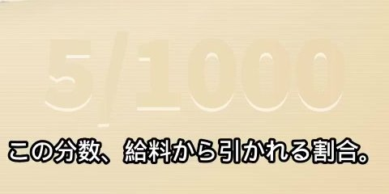
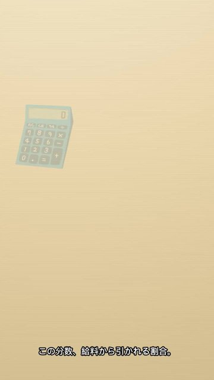
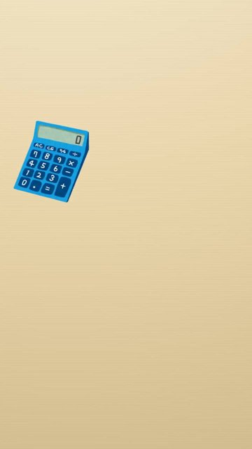

# qc kane-01

判定: NG

出力: `kane-01/kane-01.mp4`（720×1280、22.00秒、音声 aac 1本）。塗りの帯は置いていない。声は前と同じ Keita。元の音声は無い。

## 何が NG だったか

0:14〜0:20 の右下は、紙の色で塗った矩形がグラデーションと違って見えていた。中央の「5/1000」は塗りの縁が残って読めた。

## 今回の切り方

塗るのをやめた。元の 1080×1920 から、左 720×高さ 1280 を y=640 から切り、そのまま 720×1280 にした。

- 「5/1000」は y=450〜617。切り出しの上端は y=640 なので、分数は画面の上の外。1秒、8秒、12秒、14.5秒、16秒、17秒、19秒の完成画面で、赤い文字の画素は 0。
- 会社員は x=765 より右。切り出しは x=720 で終わるので、頬の手も含めて画面の右の外。16秒の完成画面で、右端 80px は 1秒の紙と画素が同じ（変化 0）。

電卓は画面の左に残る。字幕は下。PR は 20〜22秒。

## 5項目

1. 元の声の上にナレーションを重ねない: OK。音声は前の Keita と BGM のまま。
2. セリフ・字幕が画面と一致: NG。分数と明細の見出しは、この切り出しの外にある。下の表。
3. 体の欠け・映像の破綻なし: OK。会社員は画面に入っていない。帯も無い。
4. セリフ間の空白は最大1.5秒: OK。前と同じで 0.13〜1.17秒。
5. フレームを見て表を作った: OK。上の秒を見た。

分数を画面の外に出し、かつ明細の見出し（y=290〜360、幅およそ 340px）を切らずに残す 9:16 の窓は取れない。見出しの下すぐが分数なので、見出しごと収まる高さにすると幅が約 250px になり、見出しの文字を途中で切る。

## シーン表

| 秒 | セリフ・字幕 | 画面に映っているもの | 一致 |
|---|---|---|---|
| 0.20–1.76 | この分数、給料から引かれる割合。 | 紙と、左下だった電卓の位置。分数は画面の外 | 不一致 |
| 2.10–3.97 | 雇用保険料の話。毎月引かれてる。 | 同じ | 一致 |
| 4.10–4.61 | 引かれた分は、 | 同じ | 一致 |
| 5.40–6.44 | 明細の控除の欄に出てくる。 | 明細の見出しは画面の上の外 | 不一致 |
| 7.60–9.18 | 一度、自分の明細で探してみるといい。 | 同じ。自分の明細を見る話 | 一致 |
| 9.60–11.18 | 額は、給料にこの割合をかけて決まる。 | 電卓は見える。割合の分数は画面の外 | 不一致 |
| 11.60–12.94 | 割合は、年度ごとに見直される。 | 電卓と紙 | 一致 |
| 13.60–14.03 | 今年度は、 | 同じ | 一致 |
| 14.60–15.53 | 前の年より少し下がった。 | 会社員は画面の外。余分な手は映らない | 一致 |
| 16.50–17.87 | 会社は、本人より多く払ってる。 | 同じ | 一致 |
| 18.40–19.80 | 失業や育休の給付は、ここから。 | 同じ | 一致 |
| 20.00–22.00 | 声なし。画面文字「PR｜広告を含みます」 | 暗色のエンドカード | 一致 |

投稿できる状態ではない。台本の「この分数」「明細の控除の欄」「この割合」を、画面に残るものへ直してから再開する。
