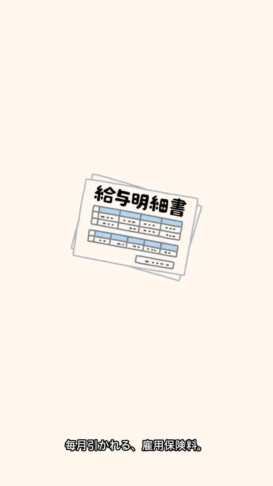
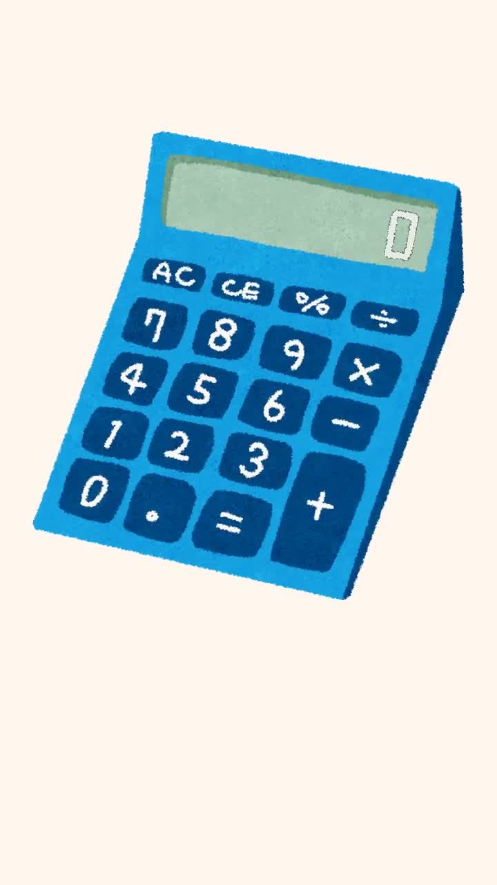
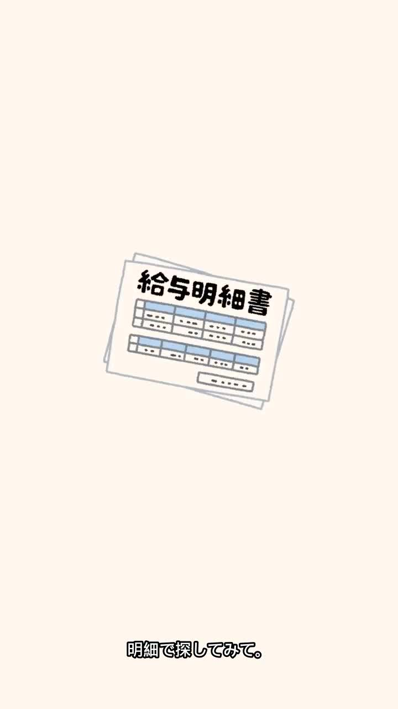

# qc kane-01

判定: 絵を差し替えて確認

出力: `kane-01/kane-01.mp4`（720×1280、22.00秒、30fps、660フレーム、h264、音声 aac 1本）。Imagine の映像は使っていない。声と字幕と尺は前の書き出しのまま。音声 aac の md5 は差し替え前と一致（`509ec225ed9b60b4af44accf50b8b7ff`）。Keita +45%。全行同じ速さ。行ごとの atempo は無い。BGM は小さい。PR は 20〜22秒。

絵はいらすとや。セリフに合わせてフェードし、少し拡大する。幅広の帯は無い。給与明細は元の絵を切らず、白い地は透過にして、画面の中に置いた（1秒の絵は x=186〜533、y=456〜741）。ビルと会社員も画面端で切っていない（15.2秒は x=21〜697）。電卓の表示窓の数字は消してある。絵の下端は字幕より上。

## 画面

## 発話の芯

次の行の開始までの無音は 0.298〜0.927秒。声は変えていない。

| 行 | セリフ | 枠 | 発話の芯 | 終わる秒 | 次 |
|---|---|---|---|---|---|
| 1 | 毎月引かれる、雇用保険料。 | 1.70 | 1.514 | 1.714 | 2.10 |
| 2 | 何のために払ってるか、知ってる？ | 1.80 | 1.471 | 3.571 | 4.10 |
| 3 | 失業したときや、 | 1.20 | 0.695 | 4.795 | 5.40 |
| 4 | 育休中にもらえる給付のため。 | 2.00 | 1.273 | 6.673 | 7.60 |
| 5 | 引かれた額は、給与明細に載ってる。 | 1.80 | 1.702 | 9.302 | 9.60 |
| 6 | 給料に割合をかけて出す。 | 1.80 | 1.124 | 10.724 | 11.60 |
| 7 | その割合は、年度ごとに変わる。 | 1.80 | 1.535 | 13.135 | 13.60 |
| 8 | それと、 | 0.90 | 0.238 | 13.838 | 14.60 |
| 9 | 払ってるのは本人だけじゃない。 | 1.70 | 1.242 | 15.842 | 16.50 |
| 10 | 会社のほうが、多く払ってる。 | 1.70 | 1.313 | 17.813 | 18.40 |
| 11 | 明細で探してみて。 | 1.50 | 0.834 | 19.234 | 20.00 |

## シーン表

| 秒 | セリフ | 画面に映っている絵 | 一致 |
|---|---|---|---|
| 0.20–3.57 | 毎月引かれる、雇用保険料。／何のために払ってるか、知ってる？ | 給与明細を丸ごと。白い四角は無い。`qc-frame-1s.jpg` | 一致 |
| 4.10–4.80 | 失業したときや、 | 失業した男性。`qc-frame-4s.jpg` | 一致 |
| 5.40–6.67 | 育休中にもらえる給付のため。 | 赤ちゃんを連れた父親。`qc-frame-6s.jpg` | 一致 |
| 7.60–9.30 | 引かれた額は、給与明細に載ってる。 | 給与明細 | 一致 |
| 9.60–13.84 | 給料に割合をかけて出す。／その割合は、年度ごとに変わる。／それと、 | 電卓。表示窓に数字は無い。`qc-frame-10s.jpg` | 一致 |
| 14.60–15.84 | 払ってるのは本人だけじゃない。 | 左に会社のビル、右に会社員。`qc-frame-15s.jpg` | 一致 |
| 16.50–17.81 | 会社のほうが、多く払ってる。 | 同じ配置。ビルのほうが大きい。`qc-frame-17s.jpg` | 一致 |
| 18.40–19.23 | 明細で探してみて。 | 給与明細。`qc-frame-19s.jpg` | 一致 |
| 20.00–22.00 | 声なし。画面文字「PR｜広告を含みます」 | 暗色のエンドカード。`qc-frame-21s.jpg` | 一致 |

## 素材の出どころ

概要欄の「イラスト：いらすとや」はそのまま。リポジトリには PNG が無かったので、記事の画像から取った。

| 絵 | 記事 | ファイル |
|---|---|---|
| 給与明細 | https://www.irasutoya.com/2015/09/blog-post_59.html | `money_kyuuyo_kyuuryou_meisai.png`（切らず、白い地は透過） |
| 失業の人 | https://www.irasutoya.com/2017/07/blog-post_311.html | `job_shitsugyou_man.png` |
| 育休の親子 | https://www.irasutoya.com/2020/03/blog-post_132.html | `ikuji_kodure_syukkin_businessman.png` |
| 電卓 | https://www.irasutoya.com/2013/03/blog-post_3975.html | `bunbougu_dentaku.png`（表示の数字は消した） |
| 会社のビル | https://www.irasutoya.com/2016/03/blog-post_89.html | `building_kaisya_blank.png`（看板なし） |
| 会社員 | https://www.irasutoya.com/2016/03/blog-post_36.html | `kaisya_man.png` |

## 5項目

1. 元の声の上にナレーションを重ねない: OK。aac は差し替え前と同一。
2. セリフ・字幕が画面と一致: OK。上の表。明細は切っていない。
3. 体の欠け・映像の破綻なし: OK。帯は無い。絵は字幕より上。
4. セリフ間の空白は最大1.5秒: OK。最大 0.927秒。声は変えていない。
5. フレームを見て表を作った: OK。上の静止画。
