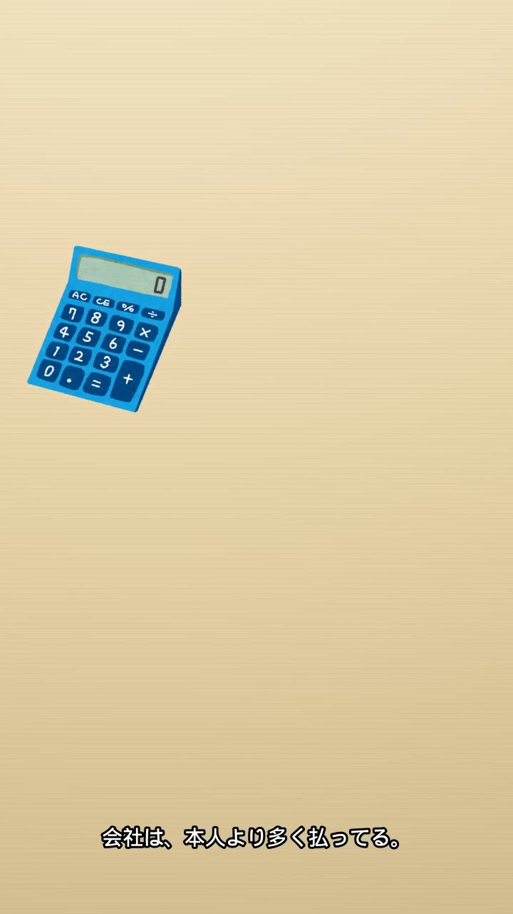

# qc kane-01

判定: OK

出力: `kane-01/kane-01.mp4`（720×1280、22.00秒、映像 h264 1本、音声 aac 1本）。切り方は前回のまま。元の 1080×1920 から左 720×高さ 1280 を y=640 から切っている。声は Keita、全行同じ速さ（+75%）。行ごとの atempo は使っていない。元の音声は無い。PR は 20〜22秒だけ。

## 画面

赤い文字の画素（分数）は、1秒・5秒・8秒・10秒・14.7秒・16.8秒・19.2秒で 0。右端 80px は 1秒と比べて平均の差が 0.6 未満で、会社員は入っていない。21秒だけ差が大きく、そこは PR。左の電卓の明るさは 1秒と 8秒が 198、10秒以降が 186。9.6秒あたりから濃くなる、という台本の絵と合う。字幕は下（白い行が y 約 1127〜1183）。5秒はセリフの間で、字幕の白い行は無い。

## 文字起こし

Whisper small。聞き違えはある。数字は出ていない。最後の行は最後まで入っている。

- 通し: 「給料から毎月惹かれる、保養保険療、何のために払ってるか、知ってる。／失業した時や、育急中にもらえる給付のため。／聞かれた額は、給与明祭に乗ってる。額は、給料に決まった割合をかけて出す。その割合は、年度ごとに変わる。それと、払ってるのは本人だけじゃない。／会社は、本人より多く払ってる。一度、自分の明祭で探してみるといい。」
- 17.8〜20.3秒: 「一度自分の名祭で探してみるといい」（19.80まで）。台本の「一度、自分の明細で探してみるといい。」

## 指していないか

全行に「この」「右の」「真ん中」は無い。分数も金額も読んでいない。「その割合」は直前のセリフの割合のことで、画面の分数を指していない。分数は切り出しの外にある。「給与明細に載ってる」「自分の明細」は、見る人の明細の話で、画面の外にある見出しを指していない。画面に残っているのは紙と電卓。

## 5項目

1. 元の声の上にナレーションを重ねない: OK。音声は aac 1本。中身は Keita と小さな BGM。
2. セリフ・字幕が画面と一致: OK。下の表。画面に無い分数・会社員・見出しを指す行は無い。
3. 体の欠け・映像の破綻なし: OK。会社員は画面の外。帯は置いていない。
4. セリフ間の空白は最大1.5秒: OK。発話の終わりから次の開始まで 0.27〜1.10秒。音量でも行の間は最大 1.2秒。
5. フレームを見て表を作った: OK。上の秒の画素と静止画。

## シーン表

| 秒 | セリフ・字幕 | 画面に映っているもの | 一致 |
|---|---|---|---|
| 0.20–1.83 | 給料から毎月引かれる、雇用保険料。 | 紙と左の電卓。分数は画面の外。`qc-frame-1s.jpg` | 一致 |
| 2.10–3.36 | 何のために払ってるか、知ってる？ | 同じ | 一致 |
| 4.10–4.72 | 失業したときや、 | 同じ | 一致 |
| 5.40–6.50 | 育休中にもらえる給付のため。 | 同じ | 一致 |
| 7.60–9.05 | 引かれた額は、給与明細に載ってる。 | 紙と電卓。見出しは画面の外。この行は見出しを指していない | 一致 |
| 9.60–11.27 | 額は、給料に決まった割合をかけて出す。 | 電卓が濃くなっている。`qc-frame-10s.jpg`。分数は読まない | 一致 |
| 11.60–12.91 | その割合は、年度ごとに変わる。 | 紙と濃い電卓。分数は画面の外で、行はそれを指していない | 一致 |
| 13.60–13.84 | それと、 | 同じ | 一致 |
| 14.60–15.67 | 払ってるのは本人だけじゃない。 | 会社員は画面の外。行は人を指していない | 一致 |
| 16.50–17.87 | 会社は、本人より多く払ってる。 | 同じ。`qc-frame-16s.jpg` | 一致 |
| 18.40–19.98 | 一度、自分の明細で探してみるといい。 | 紙と電卓。`qc-frame-19s.jpg`。文字起こしは最後までこの文 | 一致 |
| 20.00–22.00 | 声なし。画面文字「PR｜広告を含みます」 | 暗色のエンドカード。`qc-frame-21s.jpg` | 一致 |
