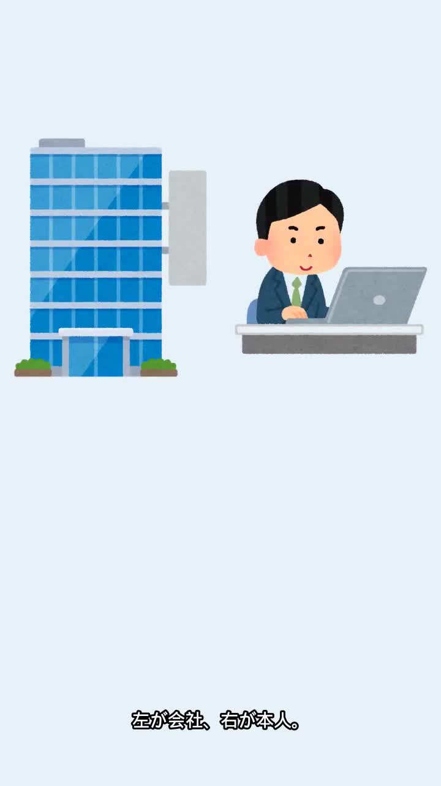
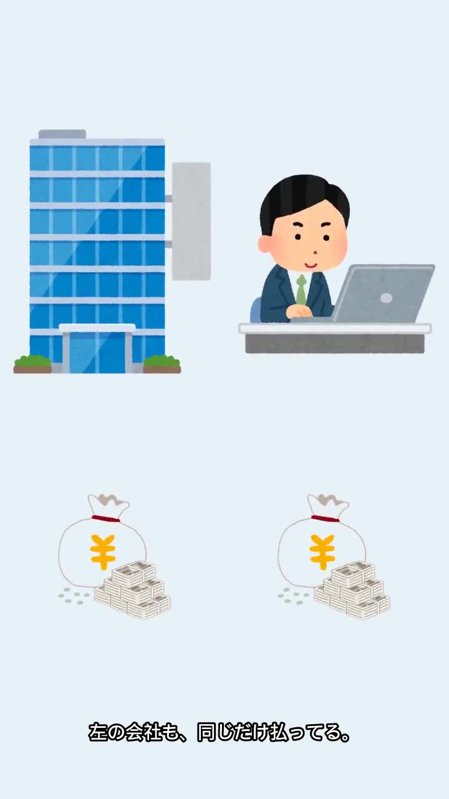
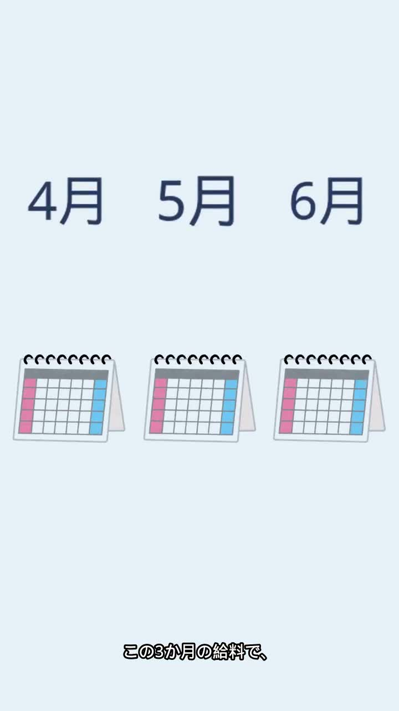
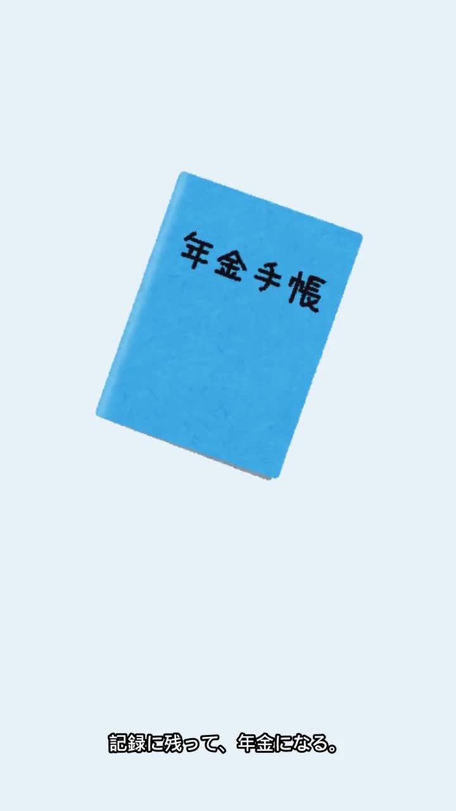

# qc kane-02

判定: 絵を差し替えて確認

出力: `kane-02/kane-02.mp4`（720×1280、30.00秒、30fps、900フレーム、h264、音声 aac 1本）。Imagine の映像は使っていない。声と字幕と尺は前の書き出しのまま。音声 aac の md5 は差し替え前と一致（`f41b79328233842625e30017f8bb38d7`）。Keita +45%。全行同じ速さ。行ごとの atempo は無い。BGM は小さい。PR は 28〜30秒。

絵はいらすとや。セリフに合わせてフェードし、少し拡大する。幅広の帯は無い。お金は円マークの袋で、両側は同じ画素サイズ。給与明細は元の絵を切らず、白い地は透過。ビルと会社員は画面端で切っていない（9.5秒は x=23〜697、右端まで 22px 余る）。絵の下端は字幕より上。

## 10行の早口について

10行目だけ「この3か月の給料で、」に替えた。Keita +45%。発話の芯は 1.033秒。17.20 に始まり、終わりは 18.233。次の行は 19.30 で、間は 1.067秒。atempo は無い。この行以外の波形は 17.055〜18.896 の外で差し替え前と同じ。画面は 4月・5月・6月のカレンダー3つのまま。

## 画面

左右の色で確認した。1秒の左半分の絵は青（ビル）、右半分は灰色（会社員）。8秒と14秒のお金の袋は、左が幅 200×高さ 208、右が幅 200×高さ 208（14秒は 198×208 と 199×207。同じ素材、同じ高さ）。12秒は下側の絵が右だけ（左 0、右 10994 画素）。

## 発話の芯

次の行の開始までの無音は、10行目が 1.067秒、それ以外は 0.989秒まで。

| 行 | セリフ | 枠 | 発話の芯 | 終わる秒 | 次 |
|---|---|---|---|---|---|
| 1 | 左が会社、右が本人。 | 1.70 | 1.357 | 1.657 | 2.20 |
| 2 | 厚生年金の保険料の話。 | 1.70 | 1.309 | 3.509 | 4.10 |
| 3 | これ、だれが払ってると思う？ | 1.80 | 1.312 | 5.412 | 6.10 |
| 4 | 答えは、 | 0.80 | 0.316 | 6.416 | 7.10 |
| 5 | 会社と本人で、半分ずつ。 | 1.90 | 1.449 | 8.549 | 9.20 |
| 6 | じゃあ、明細に出るのはどっち？ | 1.80 | 1.478 | 10.678 | 11.20 |
| 7 | 右の本人の半分だけ。 | 1.80 | 1.034 | 12.234 | 13.20 |
| 8 | 左の会社も、同じだけ払ってる。 | 1.80 | 1.603 | 14.803 | 15.20 |
| 9 | 額はどう決まるかというと、 | 1.80 | 1.011 | 16.211 | 17.20 |
| 10 | この3か月の給料で、 | 2.00 | 1.033 | 18.233 | 19.30 |
| 11 | 毎年9月に見直される。 | 1.70 | 1.047 | 20.347 | 21.20 |
| 12 | 9月の明細で、見比べてみて。 | 1.80 | 1.538 | 22.738 | 23.20 |
| 13 | 払った分は、どうなる？ | 1.80 | 1.079 | 24.279 | 25.20 |
| 14 | 記録に残って、年金になる。 | 1.80 | 1.479 | 26.679 | 27.10 |
| 15 | 半分ずつ。 | 0.80 | 0.452 | 27.552 | 28.00 |

## シーン表

| 秒 | セリフ | 画面に映っている絵 | 一致 |
|---|---|---|---|
| 0.30–6.42 | 左が会社、右が本人。／厚生年金の保険料の話。／これ、だれが払ってると思う？／答えは、 | 左に会社のビル、右に会社員。`qc-frame-1s.jpg` | 一致 |
| 7.10–8.55 | 会社と本人で、半分ずつ。 | 左にビルと袋、右に会社員と袋。袋は同じ大きさ。`qc-frame-8s.jpg` | 一致 |
| 9.20–10.68 | じゃあ、明細に出るのはどっち？ | 左にビル、右に会社員、中央下に給与明細 | 一致 |
| 11.20–12.23 | 右の本人の半分だけ。 | 左はビルだけ。右に会社員と袋。`qc-frame-12s.jpg` | 一致 |
| 13.20–14.80 | 左の会社も、同じだけ払ってる。 | 左にビルと袋、右に会社員と袋。同じ大きさ。`qc-frame-14s.jpg` | 一致 |
| 15.20–16.21 | 額はどう決まるかというと、 | 左にビル、右に会社員 | 一致 |
| 17.20–18.23 | この3か月の給料で、 | 4月・5月・6月の文字と、カレンダーが3つ。`qc-frame-18s.jpg` | 一致 |
| 19.30–20.35 | 毎年9月に見直される。 | 「9月」とカレンダー。`qc-frame-20s.jpg` | 一致 |
| 21.20–22.74 | 9月の明細で、見比べてみて。 | 「9月」と給与明細（丸ごと。白い地は透過）。`qc-frame-22s.jpg` | 一致 |
| 23.20–25.20 | 払った分は、どうなる？ | 年金手帳 | 一致 |
| 25.20–26.15 | 記録に残って、 | 年金手帳。`qc-frame-25s.jpg` | 一致 |
| 26.15–27.10 | 年金になる。 | 年金手帳を持ったおじいさん。`qc-frame-26s.jpg` | 一致 |
| 27.10–27.55 | 半分ずつ。 | 左にビルと袋、右に会社員と袋。`qc-frame-27s.jpg` | 一致 |
| 28.00–30.00 | 声なし。画面文字「PR｜この動画は広告を含みます」 | 暗色のエンドカード。`qc-frame-29s.jpg` | 一致 |

## 素材の出どころ

概要欄の「イラスト：いらすとや」はそのまま。リポジトリには PNG が無かったので、記事の画像から取った。月の文字（4月・5月・6月・9月）だけこちらで足した。

| 絵 | 記事 | ファイル |
|---|---|---|
| 会社のビル | https://www.irasutoya.com/2016/03/blog-post_89.html | `building_kaisya_blank.png` |
| 会社員 | https://www.irasutoya.com/2016/03/blog-post_36.html | `kaisya_man.png` |
| お金の袋 | https://www.irasutoya.com/2013/04/blog-post_24.html | `money_bag_yen.png`（円マーク。数字は無い） |
| 給与明細 | https://www.irasutoya.com/2015/09/blog-post_59.html | `money_kyuuyo_kyuuryou_meisai.png`（切らず、白い地は透過） |
| カレンダー | https://www.irasutoya.com/2015/01/blog-post_256.html | `calender_takujou.png` |
| 年金手帳 | https://www.irasutoya.com/2013/12/blog-post_5902.html | `nenkin_techou_blue.png` |
| お年寄り | https://www.irasutoya.com/2013/12/blog-post_645.html | `nenkin_techou_man.png` |

## 5項目

1. 元の声の上にナレーションを重ねない: OK。aac は差し替え前と同一。
2. セリフ・字幕が画面と一致: OK。左はビル、右は会社員。明細は切っていない。
3. 体の欠け・映像の破綻なし: OK。帯は無い。0〜28秒は静止画ではない。
4. セリフ間の空白は最大1.5秒: OK。最大は 10行目のあと 1.067秒。10行に atempo は無い。
5. フレームを見て表を作った: OK。上の静止画と、左右の画素。
