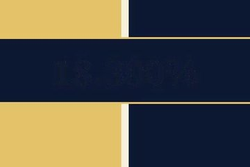
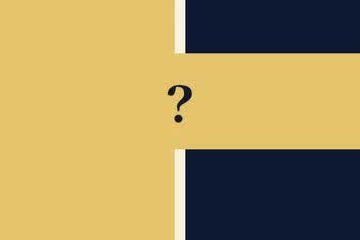

# qc kane-02

判定: NG

出力: `kane-02/kane-02.mp4`（720×1280、30.00秒、音声 aac 1本）。塗りの四角は置いていない。声は前と同じ Keita。元の音声は無い。絵の速度は変えていない。

## 何が NG だったか

中央の「18.300%」は、紺で塗っても縁が残って読めた。

## ズームでは出せなかった

「会社」は x=206〜372、「本人」は x=664〜790。百分率の箱は y=865 から。両方の文字を入れるには幅が約 580px 要り、9:16 にすると高さが約 1040px になる。百分率の上に残っている高さは約 850px で足りない。片方の文字を切らずに、数字だけを画面の外へ出す窓は無い。

## 入れた別カット

7.0秒で中央が紺の数字に替わる。6.8秒までは「？」。0〜6.8秒を使い、その最後のフレームを 28秒まで止めた。8秒、10秒、20秒、27秒の中央の明るい画素は 433 で、1秒と同じ。数字のフレームではこの帯に数千の明るい画素があった。29秒は PR。

## 5項目

1. 元の声の上にナレーションを重ねない: OK。
2. セリフ・字幕が画面と一致: NG。「真ん中の数字は、二人を合わせた率。」のとき、中央は「？」で数字が無い。6.8秒から 28秒まで絵が止まったまま。
3. 体の欠け・映像の破綻なし: OK。人物はいない。百分率は出ていない。
4. セリフ間の空白は最大1.5秒: OK。前と同じで 0.21〜0.95秒。
5. フレームを見て表を作った: OK。1秒、6.5秒、8秒、10秒、20秒、27秒、29秒を見た。

## シーン表

| 秒 | セリフ・字幕 | 画面に映っているもの | 一致 |
|---|---|---|---|
| 0.30–1.49 | 左が会社、右が本人。 | 左が金、右が紺。左に「会社」、右に「本人」。中央は「？」 | 一致 |
| 2.20–3.37 | 厚生年金の保険料の話。 | 同じ | 一致 |
| 4.10–5.27 | これ、だれが払ってると思う？ | 中央は「？」 | 一致 |
| 6.10–6.44 | 答えは、 | 中央は「？」 | 一致 |
| 7.10–8.39 | 会社と本人で、半分ずつ。 | 6.8秒の絵で止まっている。左右の文字はある | 一致 |
| 9.20–10.70 | 真ん中の数字は、二人を合わせた率。 | 中央は「？」のまま。数字は無い | 不一致 |
| 11.20–27.89 | 以降のセリフ | 同じ静止画。手帳と左右の文字は見える | 数字の行以外は一致 |
| 28.00–30.00 | 声なし。画面文字「PR｜この動画は広告を含みます」 | 暗色のエンドカード | 一致 |

投稿できる状態ではない。「真ん中の数字」を、画面に残るものへ直すか、数字の無い別の絵が要る。
