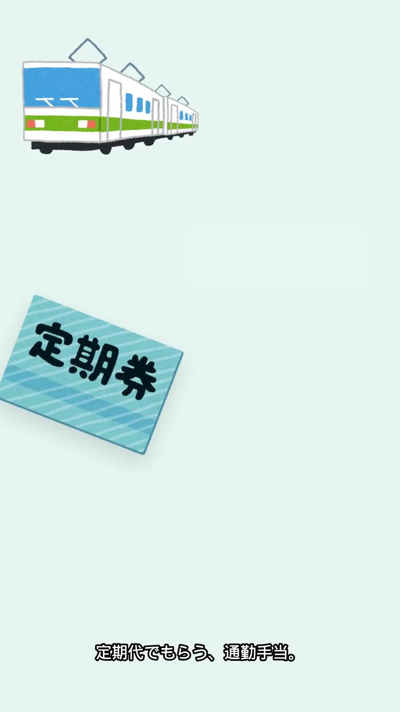
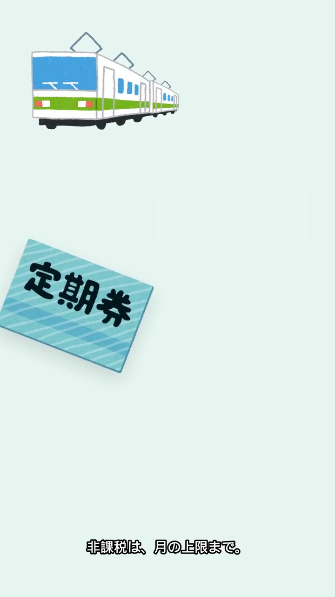
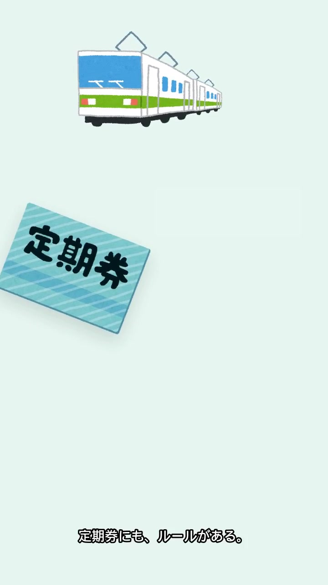
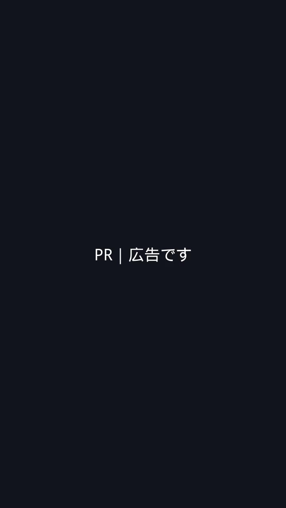

# qc kane-03

判定: OK

出力: `kane-03/kane-03.mp4`（720×1280、30.00秒、映像 h264 1本、音声 aac 1本）。映像は 0〜28秒、PR は最後の2秒。絵の速度は変えていない。金額の位置は地のミント。声は Keita +45%。全行同じ速さ。行ごとの atempo は使っていない。元の音声は無い。BGM は小さい。

## 画面

金額の帯（y=400〜530、x=300〜700）で、地のミントと差が 18 を超える画素は、1秒・6.5秒・27秒で 0。平均は (230.3, 244.3, 240.3)。電車は上、定期券は下に残る。29秒は PR。

## 文字起こし

Whisper small。6.0〜8.2秒は「機械性は、月の上限まで。」「右」「15万」「この定期代」は出ていない。最後は「定期権にも、ルールがある。」

## 発話の芯

次の行の開始までの無音は 0.377〜0.961秒。

| 行 | セリフ | 枠 | 発話の芯 | 終わる秒 | 次 |
|---|---|---|---|---|---|
| 1 | 定期代でもらう、通勤手当。 | 1.70 | 1.494 | 1.794 | 2.20 |
| 2 | これには、税金がかからない。 | 1.80 | 1.345 | 3.545 | 4.20 |
| 3 | ただ、どこまでもじゃない。 | 1.80 | 1.088 | 5.288 | 6.20 |
| 4 | 非課税は、月の上限まで。 | 1.80 | 1.360 | 7.560 | 8.20 |
| 5 | それに、基準になるのは | 2.00 | 1.161 | 9.361 | 10.30 |
| 6 | 経済的で合理的な経路。 | 1.90 | 1.139 | 11.439 | 12.40 |
| 7 | こえた分は、課税される。 | 1.80 | 1.157 | 13.557 | 14.40 |
| 8 | グリーン料金は、入らない。 | 1.80 | 1.289 | 15.689 | 16.40 |
| 9 | もうひとつ、気をつけたいのは | 1.80 | 1.357 | 17.757 | 18.30 |
| 10 | 社会保険料には、含まれること。 | 1.90 | 1.564 | 19.864 | 20.40 |
| 11 | 税金とは、別の話。 | 1.80 | 1.324 | 21.724 | 22.40 |
| 12 | 明細の通勤手当の欄、 | 1.80 | 1.075 | 23.475 | 24.30 |
| 13 | 課税か非課税か、見ておくといい。 | 1.90 | 1.509 | 25.809 | 26.40 |
| 14 | 定期券にも、ルールがある。 | 1.50 | 1.223 | 27.623 | 28.00 |

## 5項目

1. 元の声の上にナレーションを重ねない: OK。aac 1本。Keita と小さな BGM。
2. セリフ・字幕が画面と一致: OK。下の表。空いた右や金額を指す行は無い。
3. 体の欠け・映像の破綻なし: OK。顔は無い。金額の帯は地の色。
4. セリフ間の空白は最大1.5秒: OK。最大 0.961秒。
5. フレームを見て表を作った: OK。上の秒の画素と静止画。

## シーン表

| 秒 | セリフ・字幕 | 画面に映っているもの | 一致 |
|---|---|---|---|
| 0.30–1.79 | 定期代でもらう、通勤手当。 | ミントの地。上に電車。下に定期券。右の金額は地の色。`qc-frame-1s.jpg` | 一致 |
| 2.20–3.55 | これには、税金がかからない。 | 電車は右へ、定期券は上へ | 一致 |
| 4.20–5.29 | ただ、どこまでもじゃない。 | 同じ | 一致 |
| 6.20–7.56 | 非課税は、月の上限まで。 | 電車と定期券。金額は読めない。`qc-frame-6s.jpg` | 一致 |
| 8.20–9.36 | それに、基準になるのは | 電車は右上の方へ | 一致 |
| 10.30–11.44 | 経済的で合理的な経路。 | 同じ | 一致 |
| 12.40–13.56 | こえた分は、課税される。 | 同じ | 一致 |
| 14.40–15.69 | グリーン料金は、入らない。 | 同じ | 一致 |
| 16.40–17.76 | もうひとつ、気をつけたいのは | 同じ | 一致 |
| 18.30–19.86 | 社会保険料には、含まれること。 | 同じ | 一致 |
| 20.40–21.72 | 税金とは、別の話。 | 同じ | 一致 |
| 22.40–23.48 | 明細の通勤手当の欄、 | 電車と定期券。画面の欄は指していない | 一致 |
| 24.30–25.81 | 課税か非課税か、見ておくといい。 | 同じ | 一致 |
| 26.40–27.62 | 定期券にも、ルールがある。 | 電車は右寄り。定期券は最初より上。`qc-frame-27s.jpg` | 一致 |
| 28.00–30.00 | 声なし。画面文字「PR｜広告です」 | 暗色のエンドカード。`qc-frame-29s.jpg` | 一致 |
