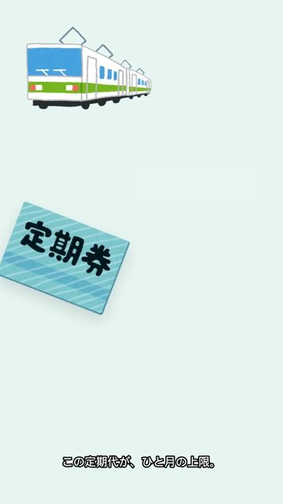

# qc kane-03

判定: OK

出力: `kane-03/kane-03.mp4`（720×1280、30.00秒、音声 aac 1本）。声は Keita（+70%）。元の音声は無い。映像は 0〜28秒、PR は最後の2秒。絵の速度は変えていない。

## 変えた1行

確定台本: 「右の金額が、ひと月の上限。」

変えた文言: 「この定期代が、ひと月の上限。」

右の金額は地の色で消してあるので、右は空である。数字は言わない。意味は、通勤手当にひと月の上限がある、のまま。指す先は画面の下にある定期。

6.5秒の完成画面。金額の帯（y=400〜530、x=320〜680）で地と違う画素は 0。電車と定期券は残っている。

Whisper small（5.8〜8.0秒）: 「この定期台が1月の超限」。台/代、1月/ひと月、超限/上限の聞き違えで、台本の新しい1行。 「右」も「15万」も出ていない。

## 5項目

1. 元の声の上にナレーションを重ねない: OK。Keita と小さな BGM だけ。
2. セリフ・字幕が画面と一致: OK。上の1行以外は確定台本のまま。定期と電車は残している。
3. 体の欠け・映像の破綻なし: OK。顔は無い。金額の塗りは地と同じミントで、縁は出ていない。
4. セリフ間の空白は最大1.5秒: OK。間隔は 0.36〜1.03秒。
5. フレームを見て表を作った: OK。6.5秒を見た。金額の位置に地と違う色は無い。

## シーン表

| 秒 | セリフ・字幕 | 画面に映っているもの | 一致 |
|---|---|---|---|
| 0.30–1.65 | 定期代でもらう、通勤手当。 | ミントの地。上に電車。下に定期券。右の金額は地の色 | 一致 |
| 2.20–3.42 | これには、税金がかからない。 | 電車は右へ、定期券は上へ | 一致 |
| 4.20–5.21 | ただ、どこまでもじゃない。 | 同じ | 一致 |
| 6.20–7.57 | この定期代が、ひと月の上限。 | 下に定期券。右の金額の位置は地の色。`qc-6s.jpg` | 一致 |
| 8.20–9.27 | それに、基準になるのは | 電車は右上の方へ | 一致 |
| 10.30–12.02 | いちばん経済的で合理的な経路の定期代。 | 同じ | 一致 |
| 12.40–13.94 | こえた分は、給料として課税される。 | 同じ | 一致 |
| 14.40–15.57 | グリーン料金は、入らない。 | 同じ | 一致 |
| 16.40–17.64 | もうひとつ、気をつけたいのは | 同じ | 一致 |
| 18.30–20.04 | 社会保険料の計算には、含まれること。 | 同じ | 一致 |
| 20.40–21.93 | 税金はかからなくても、そこは別。 | 同じ | 一致 |
| 22.40–23.39 | 明細の通勤手当の欄、 | 同じ | 一致 |
| 24.30–25.67 | 課税か非課税か、見ておくといい。 | 同じ | 一致 |
| 26.40–27.77 | 定期券一枚にも、ルールがある。 | 電車は右寄り。定期券は最初より上 | 一致 |
| 28.00–30.00 | 声なし。画面文字「PR｜広告です」 | 暗色のエンドカード | 一致 |
