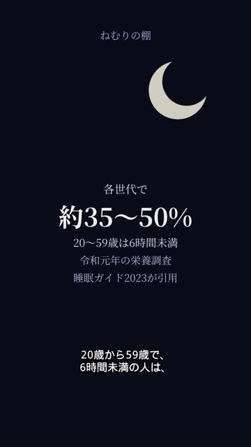

# qc nemuri-01

判定: OK

出力: `nemuri-01/nemuri-01.mp4`（720×1280、映像 h264、音声 aac 1本、26.00秒）。元の音声トラックは無い。

## 5項目

1. 元の声の上にナレーションを重ねない: OK。原因と、直し後の文字起こしは下。
2. セリフ・字幕が画面と一致: OK。15秒の画面は調査の5行で、そのときのセリフは「20歳から59歳で、6時間未満の人は、」。静止画 `qc-15s.jpg`。
3. 体の欠け・映像の破綻なし: OK。人物はいない。
4. セリフ間の空白は最大1.5秒: OK。間隔は 0.06〜1.15秒。
5. フレームと音声を見て表を作った: OK。

## 0:12〜0:20 の原因

`body_clean.mp4` の音声ストリームは 0 本。BGM は 165/196/247Hz のサインで、声は入っていない。ナレの各クリップは時間が重なっていない（前の終わりと次の始まりの差は 0.06秒以上）。

前の書き出しで 0:14〜0:18 だけ速く機械的に聞こえたのは、その2行だけ ffmpeg の atempo（1.11倍と 1.19倍）で縮めていたため。他の行は縮めていない。完成音からナレを引いた残りは BGM と一致（相関 0.98）で、別の声ではなかった。

直し: その2行も他と同じ Nanami +40% の速さで置き、重ならないよう開始をずらした。atempo は使っていない。

## 文字起こし（Whisper small、言語 ja）

時刻は本編の秒。ナレ単体は縮める前の wav を、下の開始位置に置いたもの。

ナレ単体 0:12〜0:20:

| 秒 | 聞こえた語 |
|---|---|
| 12.00–13.00 | 個人差がある |
| 13.0–14.0 | ほぼ無音 |
| 14.18–16.42 | 20歳から59歳で6時間未満の人は |
| 16.68–18.76 | 各世代で約35から50% |
| 19.20–19.84 | 令和元年（Whisper は「令和がね」） |

語の時刻は前後に重ならない。

BGM 単体 0:12〜0:20: セリフなし。

完成 mp4 の 0:12〜0:20: 上と同じ1本。「も」「例はガネ」は Whisper の聞き違えで、別の声ではない。

クリップ単体: 06 は「20歳から59歳で6時間未満の人は」だけ。07 は「各世代で約35から50%」だけ。

## シーン表

| 秒 | セリフ・字幕 | 画面に映っているもの | 一致 |
|---|---|---|---|
| 0.40–1.94 | ねえ、6時間って足りてる？ | 藍の地。右上に月。中央に「6時間、足りてる？」 | 一致 |
| 2.18–2.95 | どうなんだろうね。 | 同じ文字 | 一致 |
| 4.10–5.98 | 成人の目安は、6時間以上。 | 中央に「成人の目安は／6時間以上／睡眠ガイド2023」 | 一致 |
| 6.10–8.31 | 睡眠ガイド2023に、そうある。 | 同じ3行 | 一致 |
| 9.10–11.24 | ちょうどいいのは、おおよそ6から8時間。 | 中央に「適正はおおよそ／6〜8時間／個人差がある／睡眠ガイド2023」 | 一致 |
| 11.81–13.05 | でも、個人差がある。 | 同じ4行 | 一致 |
| 14.05–16.64 | 20歳から59歳で、6時間未満の人は、 | 中央に調査の5行。`qc-15s.jpg` | 一致 |
| 16.80–19.34 | 各世代で、約35から50%。 | 同じ5行 | 一致 |
| 19.40–21.10 | 令和元年の、栄養調査から。 | 同じ5行 | 一致 |
| 21.30–23.13 | これは、医療的な助言じゃないよ。 | 中央に「医療的な助言ではありません」 | 一致 |
| 24.00–26.00 | 声なし。画面文字「PR｜広告を含みます」 | 暗色のエンドカード | 一致 |

