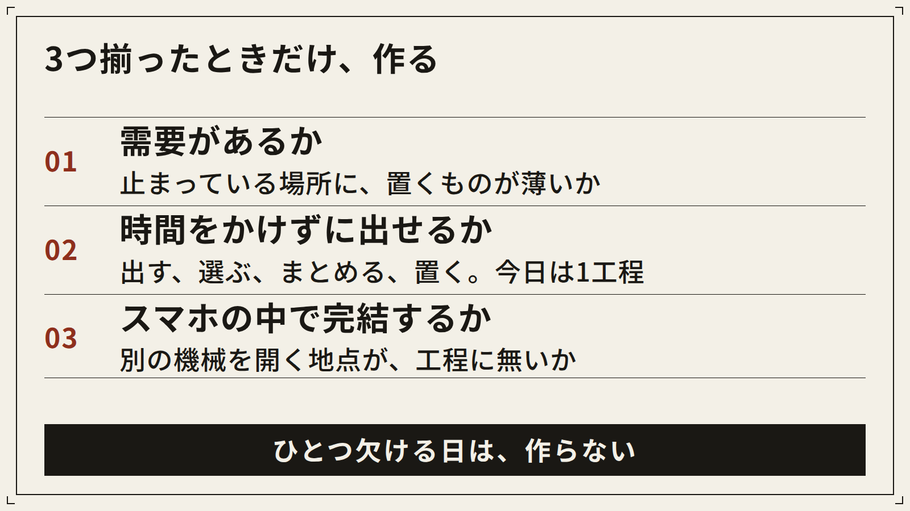
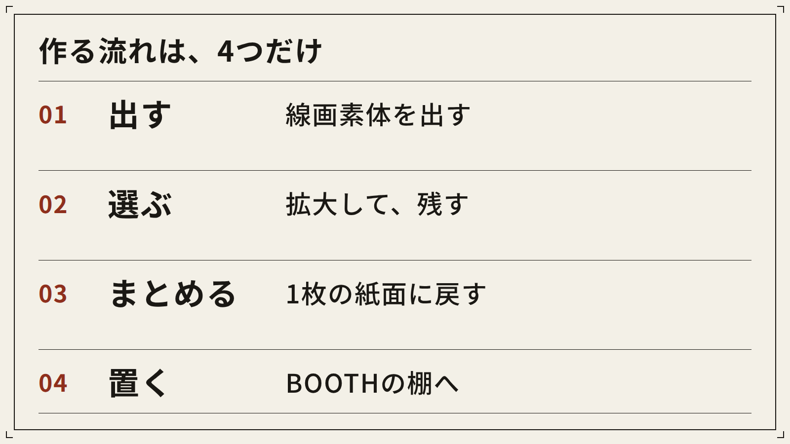
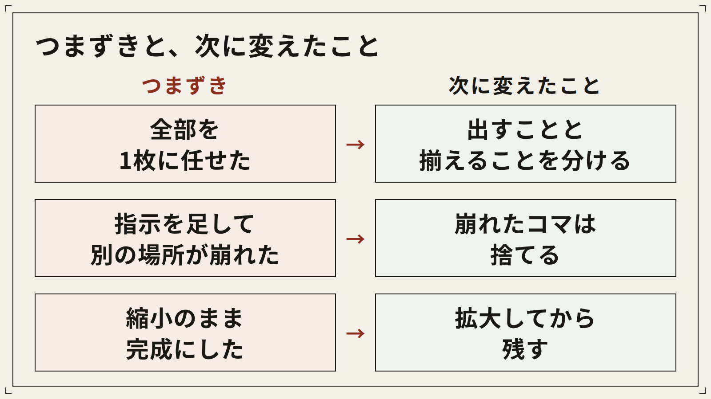
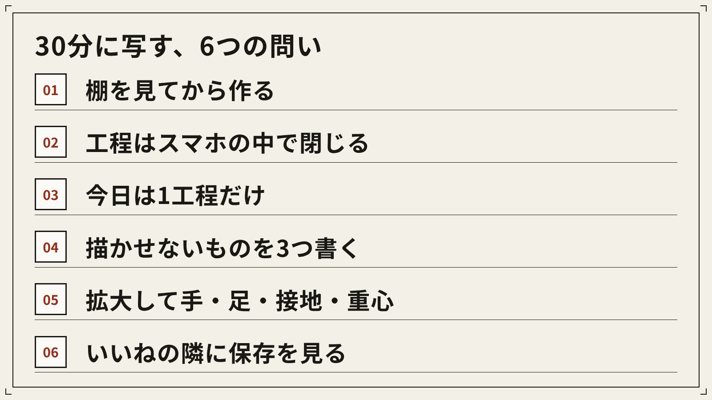
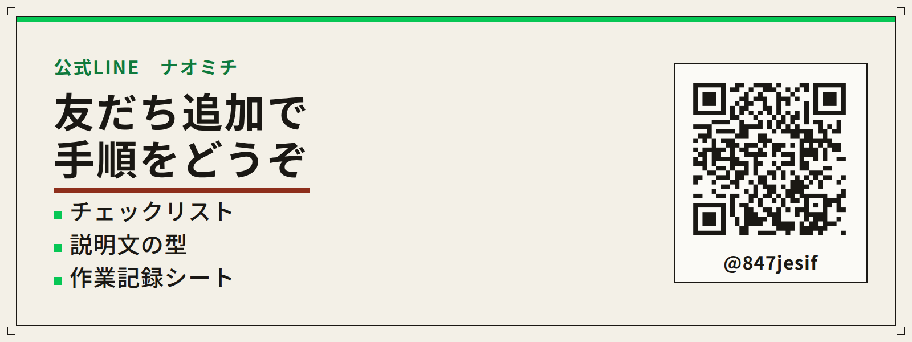

# タイトル案（投稿時はこの節を外し、下の3つから1つを見出しにする）

1. 絵描きさんの手が止まる場所に、線画のポーズ集を置いた（26字）
2. 需要があるか、スマホで出せるか。ポーズ集はそこで選んだ（27字）
3. ブックマーク1,843のポストから、ポーズ集の中身をほどく（29字）

サムネイル（X記事のヘッダー）は `images/thumbnail.png`。大見出しは「手が止まる場所に、資料を置く」。サブコピーは「43歳会社員がスマホで作ったポーズ集」。

記事中の図は `images/fig1.png` から `images/fig4.png`。元ポストの4×4は再掲していない。本文の【画像: 元ポストのポーズ集】の位置へ、ナオミチが貼る。

---

絵を描く人が、ポーズで手が止まる。頭の中には絵がある。体の角度が決まらないだけで、その日の線がゼロになる。あの止まり方の横に、線画素体の資料が置いてあったら、描く人は一度、手を動かせる。2026年10月27日の朝、僕がポストにしたのは、その置き場の話だ。

「絵描きさん、ポーズで手が止まってない？」

続きは短かった。BOOTHだと、ポーズ集は意外な穴場かもしれん。ニッチだけど、かゆいところに手が届く。スマホしか使えない僕は、需要があって、時間をかけずに出せるか、を考える。要は僕のImagine脳だ。締めは、イエス(　ﾟдﾟ)。マイルドプロンプト、とだけ添えた。

数字は、2026年11月14日時点の公開値だけを置く。表示191,013。いいね1,823。ブックマーク1,843。リポスト166。リプ21。引用1。

最初に目が行ったのは、ブックマークだった。1,843は、いいね1,823を上回っている。リポストは166、リプは21、引用は1。転送はされても、返事は少ない。残した数と、いいねした数が、ほぼ並んでいる。

僕が毎週見るのは、保存された投稿が何かだ。会話が少なくて保存が多いとき、人は今は返事をしない、あとで使う、と判断している。絵を描く人にとって、ポーズの資料は、あとで使うものに近い。表示が191,013まで届いた理由を、才能の話にはしない。止まり方の横に、あとで開ける紙面があった。僕に言えるのは、そこまでだ。

僕は絵が上手い側にはいない。43歳で、子持ちで、会社では窓際にいる。見ていたのは、手が止まる場所に資料が足りているか、足りないならスマホの中で置けるか、だ。

元ポストの4×4を、ここに置く。

【画像: 元ポストのポーズ集】

16コマの線画素体だ。背景はない。衣装のデザインもない。物語もない。絵の練習と、資料のための線だけを残すつもりで出した。同じポストには、40秒の縦動画も付いていた。どの順で何を見せたかは、記憶で書き足さない。

【要確認: 40秒の縦動画で見せた順番】

イエス、と書いたときのノリは軽い。判断は3つだけだ。需要があるか。時間をかけずに出せるか。スマホの中で完結するか。この3つが同時に立ったものだけ、親指を動かす。

## なぜポーズ集だったか

ポーズ集にしたのは、絵描きさんの止まり方と、BOOTHの棚の隙間が重なったからだ。重なったので、Grok Imagineで線画素体を出してみた。Grokは、Imagineを含めて、僕が1つを深く使い倒している道具だ。

3つの問いは、題材が決まる前から固定してある。

需要があるか。誰かがどこかで止まっていて、そこに今置いてあるものが薄いか。

時間をかけずに出せるか。出す、選ぶ、まとめる、置く。この4工程が、細切れの1片で1つ終わるか。

スマホの中で完結するか。別の機械や別のソフトを開く地点が1つでもあれば、その日の候補から外す。道具を足した瞬間に、僕の隙間は消える。

BOOTHの棚には、イラストの道具が並ぶ。筆、色、背景、3D。ポーズ集は、その並びに対して目立ちにくい。ポストに書いた「意外な穴場かもしれん」は、仮説のまま置いてある。穴場かどうかは、棚を数えたあとにしか言えない。点数と価格帯は、この本文にはまだない。

【要確認: 記事を出す時点の、BOOTHにおけるポーズ集の点数と価格帯】

需要の読みも、ここで止める。手元にあるのは、「描く人がポーズで止まる」という一文と、ブックマーク1,843件という公開の数字だ。あとで開いておきたい反応が、ここにはあった、とまでは読める。棚から出ていった数は、別の記録だ。

【要確認: 販売数と売上。未公開なら「未公開」、公開済みで0なら「0」と書く】

時間の切れ方は、生活の形から来ている。通勤と、昼の隙間。子どもがいるので、夜にまとまった時間を当てにする計画は最初から置かない。家族の話はここまでだ。まとまった時間が来てから始めようとすると、僕の場合は始まらない。

ポーズ集は、この切り方に乗った。撮影がない。長いタイムラインを引く編集もない。線画素体を出して、使えるコマを残して、同じルールの紙面に戻して、説明を短く書いて、棚に置く。置くところまでが、スマホの画面の中で想像できた。今日書くのは、想像できたところまでだ。棚に出したかどうかは、空欄のままにする。

【要確認: このポーズ集をBOOTHに公開したか。公開しているなら商品のURL】

図にすると、判断はこの3枚だ。1枚でも欠けたアイデアは、その日のうちに捨てる。面白い案を全部残すと、親指が散る。捨てる本数が減ることを、僕は前進として数えている。

## スマホの中の4工程

流れは4つだ。出す。選ぶ。まとめる。BOOTHに出す。

出すときにImagineへ頼むのは、線画素体だ。絵の練習に使うこと、資料として横に置くこと。この2つを文の中心に置く。背景は頼まない。衣装のデザインは頼まない。表情で物語は作らない。文字は入れない。残す情報は、線と、体の動きと、コマの余白だ。練習と資料から外れる雰囲気には寄せない。寄せると、棚も、見る人も、ポストで見せた紙面もズレる。

動きは、日常の動詞で足りる。立つ。座る。跪く。伸びる。振り向く。寝転ぶ。ひねる。片手を頭の上に上げる。右腕の角度、視線の向き、膝の曲げ具合を、同じ文に数字で書き始めた瞬間、マイルドから外れる。代わりに置くのは、「立って、片手を頭の上に上げる」くらいの動詞だ。数字の角度は、動詞で足りないコマだけ、そのコマだけ、1つずつ足す。一度に足さない。

マイルドプロンプトは、足さないものを先に決めておく呼び方だ。残す単語は5つに絞っている。線。素体。資料。動詞。余白。この5つから外れた単語が混ざったら、一度消してから出す。

スマホの入力欄は狭い。長い指示は、途中でどこを直したか、自分でも見失う。親指で直せる長さにしておく。それが、マイルドを保つ実用の理由だ。

実際に打ち込んだ文言は、ここに貼らない。記憶でそれっぽく書き直すと、別のプロンプトになる。残してある文言を、そのまま置く。

【要確認: 実際のプロンプト】

順はこうだ。描かせないものを3つ。今回は背景、衣装のデザイン、文字。次に、線画素体、練習と資料、動きの動詞。紙面は別の文で、4×4と余白と境界。動詞と紙面は、1文に溶かさない。出す回は素体を見る。まとめる回に、紙面を揃える。

選ぶ。出たコマを、全部は資料にしない。スマホの画面いっぱいに4×4が並ぶと、完成して見える。縮小の魔法だ。指で拡大すると、なぞれるコマと、残せないコマが混ざる。上手いかどうかは見ない。見る場所は4つだ。手の形が読めるか。足の形が読めるか。体が、置くべき場所に着いているか。重心が、そのコマの動詞と矛盾していないか。同じ動詞ばかりが紙面を占めていないかも、ここで見る。

落とした枚数は、この文章にはまだ書けない。

【要確認: 生成した回数と、採用したコマ数】

まとめる。採用したコマを、同じ線のルールで1枚に戻す。元ポストに付けた紙面は4×4だった。スマホの一覧で全体が見えて、拡大しても1コマが読める。今はその範囲の割り方を好んでいる。線の太さがコマごとに暴れると、紙面は生成の見本に見える。見たいのは、描く人が横に置いて、体をなぞれるかだ。

BOOTHに出す。説明文で、上手い絵の話はしない。誰の、どの止まり方に、何が置いてあるか。線画素体であること。練習と資料用であること。この2行は、棚を間違えないために置く。価格、収録枚数、ファイル形式、サムネに書く文言。ここを想像で埋めると、別の商品の話になる。

【要確認: 価格、収録枚数、ファイル形式、商品説明の要点】

4工程を1枚にすると、こうだ。

プロンプトの文言は、図に入れていない。図は順番だけだ。文言は、上の空欄にあとから貼る。

## つまずいた場所と、次に変えたこと

失敗は3つ書く。ポストに付けた4×4をあとから見返して、工程の言葉に戻したものだ。制作ログの回数と一致するかは、空欄で確認する。才能の話にはしない。どこで親指が早まったかだけを書く。

【要確認: この3つが、実際の制作ログと一致するか。違う失敗があれば、この節を差し替える】

1つ目。1枚に、全部を任せた。

失敗。ポーズの意味と、紙面のルールと、線の統一を、1回の生成に同時に背負わせた。一覧はポーズ集に見える。コマを拡大すると、線の強さと体の情報量が、コマごとに揺れて見える。

原因。Imagineは、頼んだ名詞を、それっぽい1枚にまとめる。資料としての一貫性は、工程を分けておかないと、ポーズの方まで一緒に揺れる。

気づき。出すことと、揃えることは、別の仕事だった。生成できたことを、資料になったことと読んでいた。

次に変えること。先に素体のポーズを出して、採用を決めてから、紙面に戻す。4×4は、まとめの結果として作る。最初の命令を、完成シートにはしない。

2つ目。指示を足して、マイルドを壊した。

失敗。手の形が読めない、足が浮いている、そう見えたコマを直そうとして、指の本数や関節の角度や見る位置を、文へ足していった。片方の腕を指定すると、反対の膝が別の動詞になる。

原因。修正のつもりが、新しい注文になっていた。注文が増えると、どれを優先するかは、僕の側で決まらない。

気づき。崩れたコマは、直すより捨てた方が速い。マイルドとは、線、素体、資料、動詞、余白の5つに戻っている状態だ。

次に変えること。直したい衝動が出たら、プロンプトを開く前に、そのコマを不採用にする。残ったコマだけで、短い文をもう一度出す。短い文の実物は、前の節の空欄に置く。

3つ目。縮小のまま、完成だと判断した。

失敗。4×4は、スマホの小ささだと埋まって見える。埋まったことを完成だとして次へ進めると、資料にならないコマが紙面に残る。シートを拡大して見直したとき、危ないのはそこだった。

原因。完成の定義を、余白が埋まったことに置いていた。資料として使える状態は、描く人が1コマを見て、体をなぞれることだ。定義が違っていた。

気づき。拡大を、工程の中に入れていなかった。道具を足さなくても、見る順番は変えられる。

次に変えること。採用の前に、1コマずつ拡大する。順番は固定する。手、足、接地、重心。この4つが読めないコマは、雰囲気が良くても落とす。雰囲気で残すと、僕自身があとで使えない。絵が上手い人なら、なおさら横に置かない。

3つを並べたのが、次の図だ。

何分で直った、という数字は持っていない。日付と、その回で落としたコマ数は、ログを見てから埋める。

【要確認: 各つまずきについて、やり直した日付と、その回で落としたコマ数】

## 自分の30分に写すとき

自分の30分に写すための問いを、6つに切った。今日の30分で全部やらなくていい。1つ持って帰れば、その日は進んでいる。図にも、同じ6つを置いてある。

1. 棚を見てから作る。見た事実だけを書く。需要がありそう、で止めて、売れた、とはまだ書かない。メモしていない点数や価格は、本文にも置かない。

2. 工程はスマホの中で閉じる。別の機械が要る地点が1つでもあれば、今日の候補から外す。

3. 今日は1工程だけ。出す、選ぶ、まとめる、置く。4つを同じ日に詰め込まない。

4. 描かせないものを3つ書く。頼む前に書く。今回のポーズ集では、背景、衣装のデザイン、文字だった。題材が変われば、3つは変わる。先に書くことだけは変えない。

5. 拡大して手・足・接地・重心。縮小の完成で止めない。1コマを拡大して、この4つを見る。どれかが読めなければ、そのコマは落とす。

6. いいねの隣に保存を見る。僕の保存は、ブックマークだ。売上は、その隣に置かない。持っていない販売数は、持っていないと書く。知らない数字は、書かない。

この6つは、次の題材でも同じところから入る。テーマは変える。型は使い回す。回しているのは、GrokのImagineひとつだ。届いた数と、棚から出ていった数は、同じ文で結ばない。この記事は、届いた側の数字だけで書いている。

今日の30分は、1ミリでいい。棚を開いて、ポーズで止まりそうな人が何を探しているか。それだけ見て終わっても、僕は前進として数える。コツコツは、その1ミリにつけている名前だ。親指でポチポチ進める時間は短い。短いので、判断は3つのままにしておく。

同じ電車で、スマホしか触れない人へ。手順の続きは、公式LINE（表示名はナオミチ）で渡している。友だち追加で届くのは、スマホだけでポーズ集を1本出す手順の冊子だ。企画から出品までと、説明文の型と、作業記録が入っている。プロンプトの実物と、まだ出ていない数字は、冊子では例と分けてある。

https://line.me/R/ti/p/@847jesif

---

本文の文字数: 5207字（タイトル案の節と本行を除く。改行・空白・見出しの#・画像記法を除き、句読点・記号・数字・【要確認】・URLを含む）
