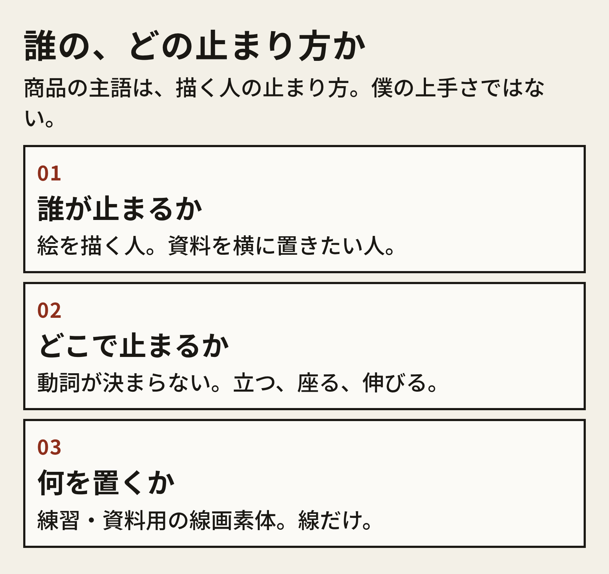
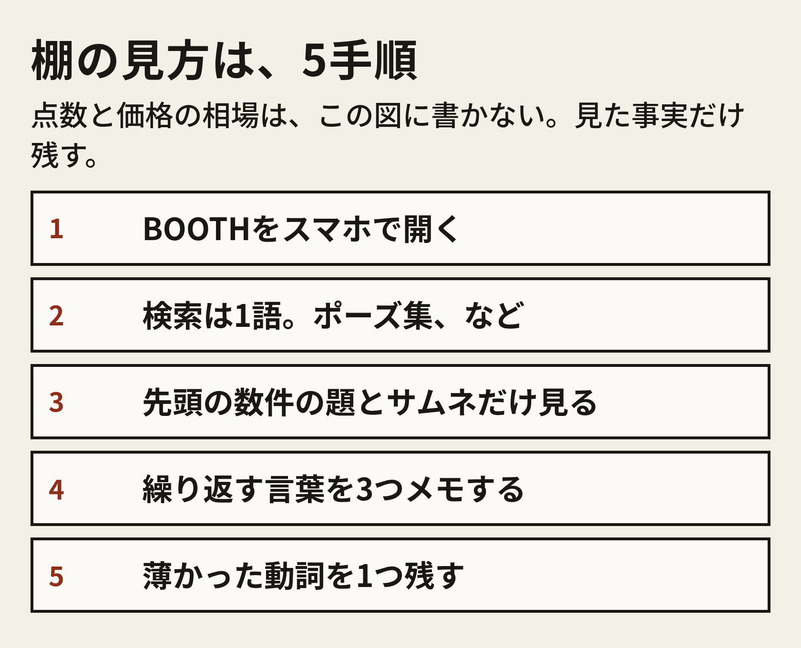
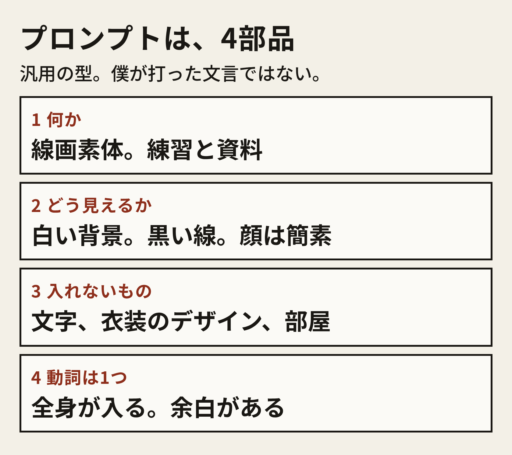
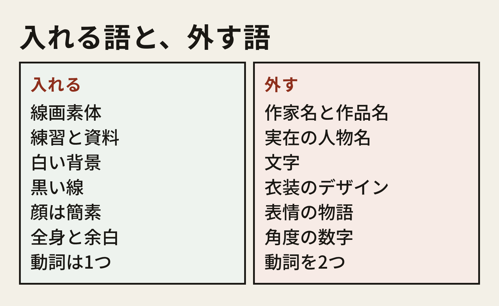
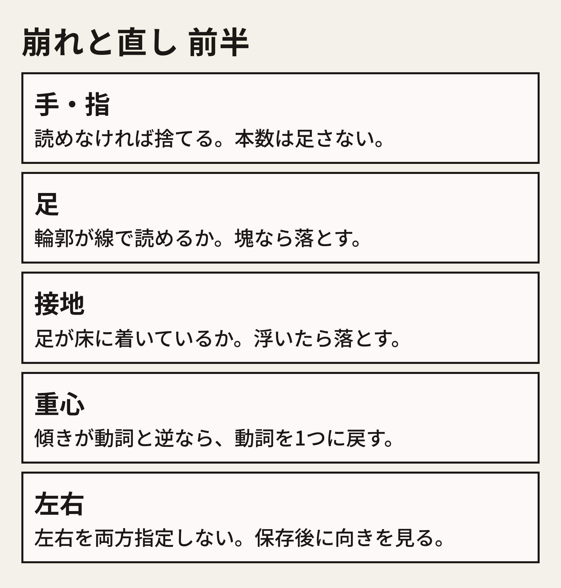
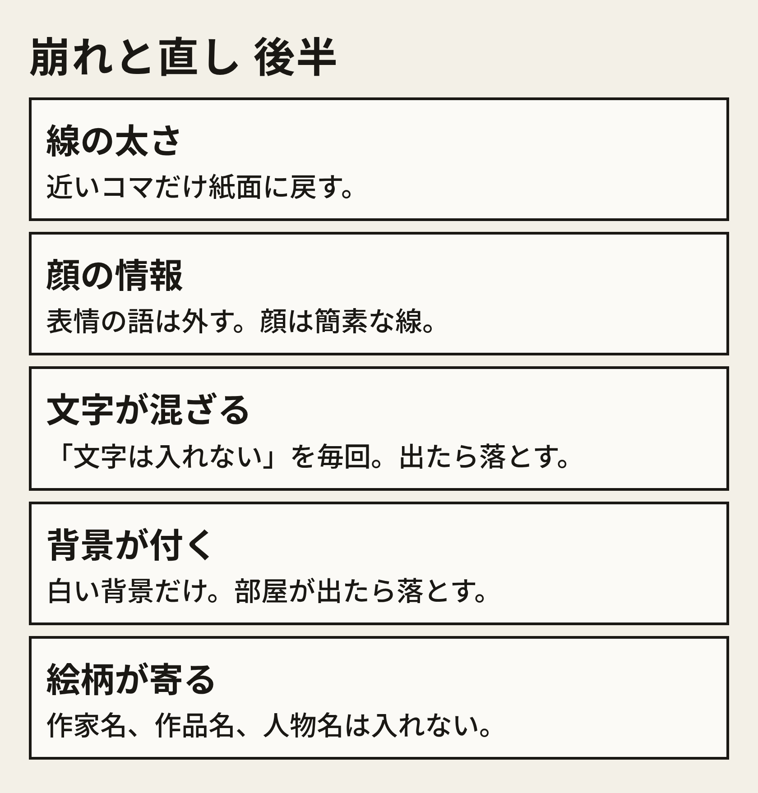
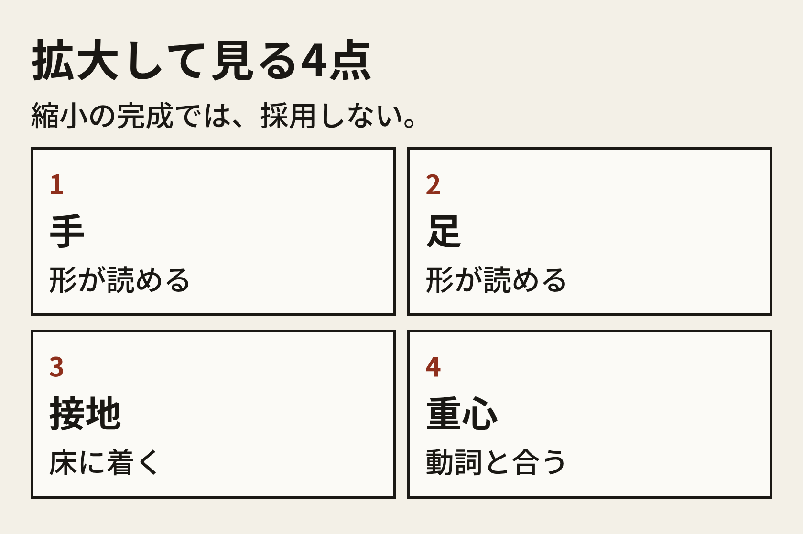
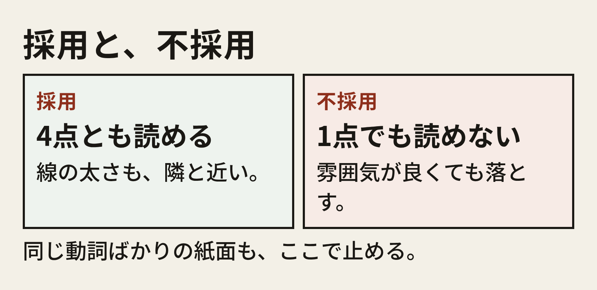
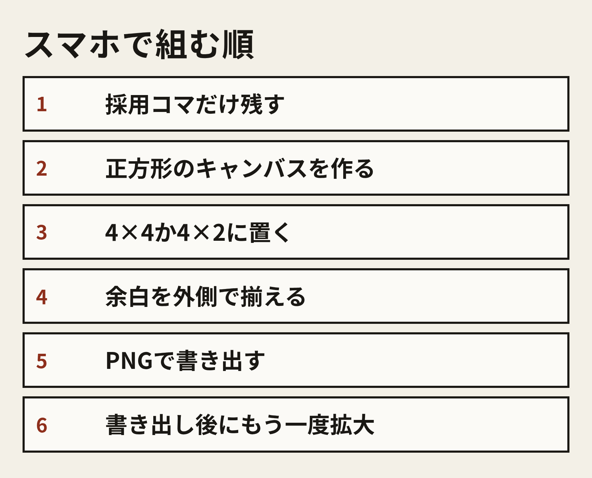
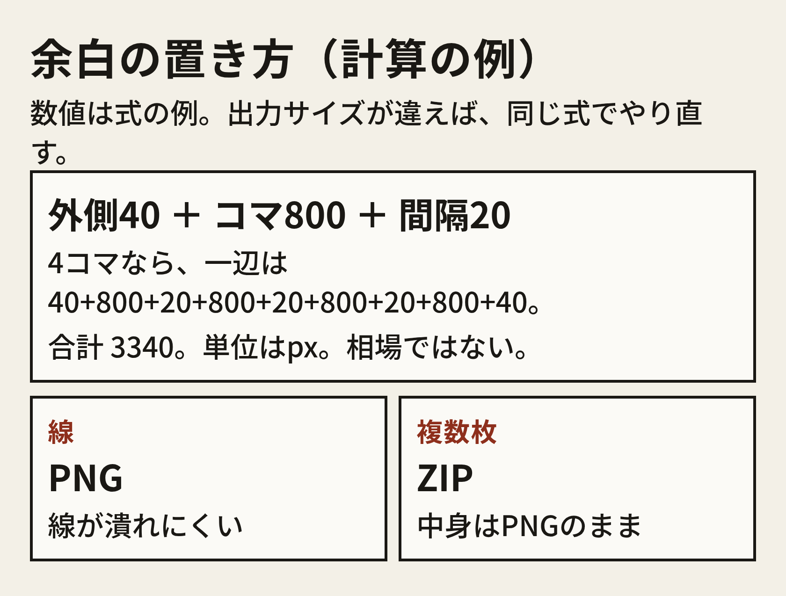

# スマホだけで、線画素体のポーズ集を1本出す

僕は43歳で、通勤のスマホからGrokのImagineを触ってる。この冊子は、そのスマホだけで、練習用の線画素体を1本、BOOTHに出すところまで持っていく手順だよ。講座じゃないから、僕がつまづきながらやってる順をそのまま置いてある。

テンプレも日程も商品名も、例だと思って読んでほしい。僕が実際に打ったプロンプトでも、売れた数でもない。数字を出すときは、そう分かるように書くね。元ポストの公開値は、出したあとの章で1回だけ使う。表示191,013、いいね1,823、ブックマーク1,843、リポスト166、リプ21、引用1。時点は2026年11月14日。

肌の描写とか衣装のデザインは、ここでは扱わない。線だけにしてあって、練習と資料から外れた絵柄が出てきたら、そのコマは捨てていい。

## 目次

- この冊子で出すもの
- 誰の止まり方に向けるか
- 棚の見方
- テーマの切り方。例が12個
- プロンプトの部品
- 汎用テンプレ。例が6本
- 崩れ方と直し方
- 拡大して選ぶ
- 紙面に組む
- 商品ページの構成
- 説明文の記入例
- タグ、サムネ、価格の考え方
- ガイドライン上の注意
- 出したあと
- つまずき12個
- 30分×12日の例
- 記録シートの記入例

# この冊子で出すもの

出すものは、白い背景の線画素体が、同じ線のルールで並んだ画像。4×2なら8ポーズ、4×4なら16ポーズで、どっちも1本になる。枚数に正解はなくて、今日の30分で採用まで届く枚数にすればいい。

ファイルはPNGを基本にして、複数枚ならZIPにまとめて、中身はPNGのままにする。JPGだと線が汚れやすいから、線画の本体には使わない方がいい。これは画質の目安で、BOOTHの必須形式じゃないよ。

1本の中身は、次の4つが揃った状態だ。

- 動詞が、題名を読んだだけで分かる
- コマを拡大すると、手、足、接地、重心が読める
- 説明文に、誰の止まり方へ置くかが書いてある
- ガイドラインのページを、出品の直前に開いた

価格は、ファイルができてからの章で考える。揃う前に値段の話を始めると、中身がぶれる。

この冊子の通し例は「床に座る」。例なので、僕の商品ページの名前じゃない。動詞を自分のものに替えるときは、テンプレの動詞の行だけ替えてね。

# 誰の止まり方に向けるか

商品の主語は、描く人の止まり方。僕が絵を上手く見せることじゃない。頭の中に絵があるのに体の角度が決まらなくて、その日の線がゼロになる。その横に線の資料が置いてある状態を作りたい。

向き先は3つに切る。

- 誰が止まるか。絵を描く人で、資料を横に置きたい人
- どこで止まるか。動詞が決まらない。立つ、座る、伸びる、振り返る
- 何を置くか。練習と資料の線画素体。背景も、衣装のデザインも、文字も無い

3つのうち1つでも自分の言葉で書けなかったら、その日は生成を開かないで、棚を見る日に回した方がいい。

床に座る、を例にすると、こう書き分けられる。

- 誰が。椅子の資料は持っているが、床の高さの体が決まらない人
- どこで。床に体重を預ける角度で、手が止まる
- 何を。床に座った線画素体。小物のデザインは描かない

「需要がありそう」で止めないでほしい。需要の材料は、次の棚の手順で自分の目に入れた言葉だけ。

# 棚の見方

BOOTHは、スマホのブラウザかアプリで開く。検索窓には語を1つだけ入れて、同時に3語入れると、何が薄かったか分からなくなる。

検索語の例を下に置くね。この語で需要が証明される、という意味じゃなくて、見るための入口。

- ポーズ集
- クロッキー
- デッサン
- 線画 資料
- 素体

1語につき、先頭に並んだ数件の題名とサムネだけ見る。全部開くと30分が溶ける。見る件数の例は5件だけど、5が正解じゃなくて、その日の画面で指が疲れない範囲にしていい。

メモは3行だけ。

- 繰り返していた言葉
- サムネを見て、線の資料に見えなかったもの
- 自分の30分で切れそうな動詞が、薄かったか

点数と価格は、見た商品についてだけ、自分の記録に書く。この冊子は相場を断定しない。見てない数字は、書かないで空欄にしておいて。

床に座る例なら、メモはこんな感じ。これは書き方の例で、僕が棚を数えた結果じゃない。

- 繰り返していた言葉の例。全身、表情、衣装差分
- 資料に見えなかったものの例。サムネが完成イラストで、角度が読めない
- 薄かった動詞の例。床に座って、手を床につく

薄かった動詞が1つ残ったら、それが今日から先のテーマ。2つ残ったら楽な方を先にして、両方を1本に入れないでね。

# テーマの切り方

テーマは、動詞1つと、その動詞の中の違いだけにする。違いって、手の位置とか、体の向きとか、体重の乗り方。衣装や物語で違いを作らない方が、資料としては見やすい。

切り方の例を12個置くね。どれも例で、この順で12本作れ、という意味じゃない。自分の棚メモに近いものを1つ選べばいい。

- 立って、片足に体重を乗せる
- 歩き出す直前で、重心が前にある
- 椅子に浅く座り、背もたれを使わない
- 床に座って、片手を床につく
- 片膝をつき、床の一点を見る
- しゃがんで、足元を見る
- 両腕を上に伸ばす
- 振り返って、肩だけが先に回る
- 荷物を持ち上げる前で、膝が曲がっている
- 手を腰に置いて立つ
- 一段高いところに、片足を乗せる
- 壁に手をつき、体が少し傾く

1本の中では、親の動詞を変えないでほしい。床に座る本に立ちを混ぜると、資料集じゃなくて見本になっちゃう。向きの違いは混ぜてよくて、正面、斜め、真横。真横は線が単純だから、最初の8枚に2枚入れると紙面が締まる。これは組み方の例。

床に座る例で、中身の8ポーズを先に言葉にしておく。生成の前に書いておくと、あとで動詞が迷子にならない。

- 両膝を曲げ、片手を床につく
- 片足を前に出し、両手は膝の上
- 横座りで、上の手は床
- 体育座りに近く、腕は膝を抱えない
- 片膝を立て、もう片方は寝かす
- 斜め前から、同じ「片手を床」
- 真横から、背中の線が読める
- 体重を後ろの手に預け、足は前

8個目まで来て動詞が似てきたら、そこで止めていい。似たコマを水増ししないで、8で1本にしてもいい。16にしたい日は、別の30分で、手の位置だけ変えた8枚を足す。

# プロンプトの部品

ここからの文言は汎用テンプレ。僕がImagineに打った実物じゃないから、コピペして動詞の行だけ替えてね。

Grokの画面に否定専用の欄があるかは、その日の画面を見てほしい。この冊子は欄の名前を決め打ちしない。欄が無いときは「入れない」を本文に1回だけ書いて、欄があるときも外す語をどんどん増やさない。増やすと、残したい動詞まで崩れる。ネガティブって、禁止リストを長くすることじゃなくて、外すものを先に3つ決めて、それ以上は足さないこと。

部品は4つ。この順で、改行して置く。

- 何か。線画素体で、練習と資料だと書く
- どう見えるか。白い背景、黒い線、顔は簡素、全身、余白
- 入れないもの。文字、衣装のデザイン、部屋。この3つで足りる
- 動詞。1つだけ。角度の数字は書かない

作家名も作品名も実在の人物名も、どの部品にも入れない。絵柄を借りるための語は、資料が綺麗になるんじゃなくて、誰かの絵に寄りすぎる。ガイドラインの章で、公式のお知らせに戻る。

1回の生成に、4×4の完成シートは頼まないでほしい。頼むと、ポーズの意味と線の統一と余白が同時に揺れる。出す回は1ポーズにして、紙面は選んだあとの別工程。

スマホの入力欄は狭いから、テンプレはこの冊子からコピーして、その場で長文を推敲しない。動詞の行だけ、親指で替える。

30分で出す枚数の目安は8枚。これは例。8枚出して保存できたら、その日は終わりにして、拡大して落とすのは次の30分に分ける。

# 汎用テンプレ

6本とも例で、動詞は「床に座る」で埋めてある。自分のテーマに替えるときは動詞の行だけ替えて、ほかの行は崩れてからしか触らない。

### テンプレA。基本の1枚

練習と資料のための線画素体。白い背景。黒い線だけ。顔は簡素。文字は入れない。衣装のデザインは描かない。部屋や小物は描かない。全身が画面に入る。余白がある。床に座って、片手を床につく。

### テンプレB。体の向きを変える

練習と資料のための線画素体。白い背景。黒い線だけ。顔は簡素。文字は入れない。衣装のデザインは描かない。部屋は描かない。全身が画面に入る。余白がある。床に座って、体は斜め。片手を床につく。

### テンプレC。真横

練習と資料のための線画素体。白い背景。黒い線だけ。顔は簡素。文字は入れない。衣装のデザインは描かない。全身が画面に入る。余白がある。真横から見た、床に座る姿勢。背中の線が読める。片手を床につく。

### テンプレD。手の位置だけ変える

練習と資料のための線画素体。白い背景。黒い線だけ。顔は簡素。文字は入れない。衣装のデザインは描かない。全身が画面に入る。余白がある。床に座って、両手は膝の上。

### テンプレE。崩れたあとの短い出し直し

線画素体。白い背景。黒い線。文字は入れない。全身。余白。床に座って、片手を床につく。

### テンプレF。動詞だけ空ける型

練習と資料のための線画素体。白い背景。黒い線だけ。顔は簡素。文字は入れない。衣装のデザインは描かない。部屋は描かない。全身が画面に入る。余白がある。動詞は1つだけ書く。例なら、片膝をついて、床の一点を見る。

テンプレFの最後の行が、毎日替える行。AからEは床に座る例として完成させてあるから、別の動詞で出す日はFをコピーして、最後の行を1つにする。

出し方の手順は、画面のボタン名に依存しない。ボタンの表記は日によって変わるので、やることはこの順。

- スマホでGrokを開き、Imagineで画像が出る画面にする
- テンプレを貼る。動詞の行だけ、今日のものにする
- 出た画像を、カメラロールに保存する
- 保存の操作名は、その日の画面に合わせる。冊子はボタン名を固定しない
- 同じ30分で、文を3回以上いじらない。崩れたらEに戻して、1回だけ出し直す

保存した画像のファイル名は、その場で短い日本語にしておく。例だと床-01、床-02。あとから選ぶ日に、どれが動詞の違いか分からなくなるのを防ぐため。

# 崩れ方と直し方

直しの原則は1つだけで、文を足す前にそのコマを落とす候補にする。足すのは、落としても動詞が足りないときだけ、語を1つ。指の本数とか関節の角度とか、カメラのミリ指定は足さない。

手と指が溶ける、本数が資料にならない、手が胴にめり込む、こういうときはそのコマを不採用にして、テンプレEの短い文で同じ動詞をもう1枚出す。本数を「5本」と書いた瞬間に別の関節が崩れることが多い。これは僕の実測回数じゃなくて、短い文に戻す理由。

足先が塊になったり、左右で大きさが違ったりしたら、基本は落とす。どうしても足の形が要るコマだけ、「足の輪郭が線で読める」を1語足してテンプレEに戻す。足のデザインや靴の説明は書かない。

体は座ってるのに足が床から浮いてたら、動詞の直後に「足が床に着いている」を1回だけ足す。それでも浮くなら、その枚は使わない。影や床の模様を足して接地をごまかすと、模様そのものが背景になっちゃう。

歩いてるのに体が後ろへ倒れたり、座ってるのに胸だけ前に飛び出したりしたら、動詞を1つに戻す。「歩きながら座る」は2枚に分けて、1枚の中の体重の方向は1つにする。

右腕と左腕が入れ替わって見えたり、肩の線が交差したりしたら、プロンプトに左右を両方書かない。「右手は床、左手は膝」は、次の出し直しでどちらか1つにする。保存した画像は写真アプリで左右を見て、資料として読める向きを残す。反転できるアプリなら、読める向きに直してから紙面へ入れる。機能の名前はアプリによる。

コマごとに輪郭の強さが違うのは、生成では揃わない前提にしておく。紙面の前に、太さが近いものだけを採用フォルダへ移して、細い線と太い線を1枚の資料に混ぜない。

笑ってる、泣いてる、物語の視線がある、となったら表情の語を外して「顔は簡素」に戻す。目の色や化粧は書かない。

画像の隅に意味のない文字が出たら、「文字は入れない」をテンプレに残したまま、そのコマを落とす。文字を消す指示を3行足さない。

床以外の部屋や窓や家具が出たら落とす。小物が動詞に必要なら、小物は「床」までに留めて、カップや本のデザインは別の資料の仕事にする。

絵柄が特定の作家に寄ったら、その語を消してテンプレAからやり直す。寄ったコマは、上手く見えても採用しない。

# 拡大して選ぶ

選ぶ日は生成を開かないで、カメラロールと、この4点だけを使う。

画面いっぱいに並んだ状態は完成に見えるけど、あれは縮小。1枚ずつ開いて指で拡大して、見る順は手、足、接地、重心。この順は飛ばさない。

判定は二択でいい。4点が読めるコマは採用、1点でも読めないコマは不採用。雰囲気がいいとか、顔の好みとか、なんとなく上手い、では残さない。

同じ動詞が8枚中6枚を占めてたら、紙面にする前に2枚外す。外した分は次の出す日に、手の位置だけ変えたテンプレDで補う。足りないまま8枚に水増ししない。6枚で1本にする判断もあって、6枚なら4×2にせず2×3でも資料になる。割り方は、読めるコマの数に合わせる。

不採用の枚数は、その日数えた数だけ記録シートに書く。数えてなければ空欄のままにして、それらしい数字で埋めない。

採用フォルダの名前の例は、床-採用。不採用は床-落とし。30分の終わりに、採用が何枚あるかを指で数えて、数えた数をシートに書く。

# 紙面に組む

組む道具は、スマホで画像を並べられて、PNGで書き出せるものにする。無料の範囲を先に使って、名前は実在するものだけ書く。無料プランの上限や透かしは、アプリのその日の画面で見て、透かしが乗った書き出しは資料にしない。

- Canva。スマホアプリがある。無料プランで、カスタムサイズのデザインを作り、画像を置いて、PNGで書き出せる
- ibisPaint。基本無料で、広告がある。キャンバスに画像を読み込み、並べて書き出せる
- Adobe Express。スマホアプリがある。無料プランで、カスタムサイズに画像を置ける
- Photopea。ブラウザで開く無料の画像編集だ。スマホでも開く。重い日は、通信のよい場所の30分に回す

操作の名前はアプリで違うけど、順は同じでいい。

- 採用コマだけを、一つのアルバムに残す
- 正方形のキャンバスを作る
- 4×4か4×2に、端から置いていく
- コマの間隔と、外側の余白を目で揃える
- 顔の大きさが極端に違うコマは、その場で拡大縮小する。形が崩れるなら、そのコマを外す
- PNGで書き出す
- 書き出したファイルを開き、もう一度拡大する。線が潰れていたら、キャンバスを大きくして書き直す

大きさの式は例。1コマの長辺を800px、コマの間隔を20px、外側の余白を40pxにする場合、4コマの一辺は次の合計になる。

40+800+20+800+20+800+20+800+40。合計は3340px。

Imagineの出力が800pxじゃなければ、出力の長辺を800の位置に入れて、同じ足し算をやり直す。3340が必須サイズじゃなくて、指で拡大したときに手の線がまだ読めることが目安。

線の色は、黒に近い1色で揃える。コマによって灰色と黒が混ざってたら、紙面の前にどちらかへ寄せる。寄せる機能がアプリに無ければ、太い方か細い方のどちらかだけ残す。色を盛ってごまかさない。

背景は白。透過PNGだと、相手の画面色で線が消えることがあるから、線画の資料は白を塗ったPNGを先にする。透過が必要だと棚で見たときだけ、白版と透過版をZIPに両方入れる。必要かどうかは、自分が見た棚のメモで決める。

書き出した正方形を、スマホの写真アプリで全画面にして、四隅の余白が同じか見る。片側だけ余白が無い紙面は、資料というより生成の見本に見えるので、余白を足して書き出す。

ここまでで、ファイルが1枚、手の中にある。次は、そのファイルをBOOTHの商品ページにする。説明文の型と記入例は、続きの章。
