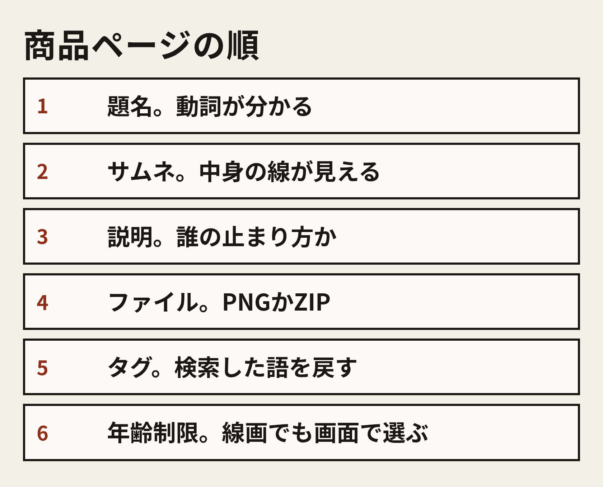
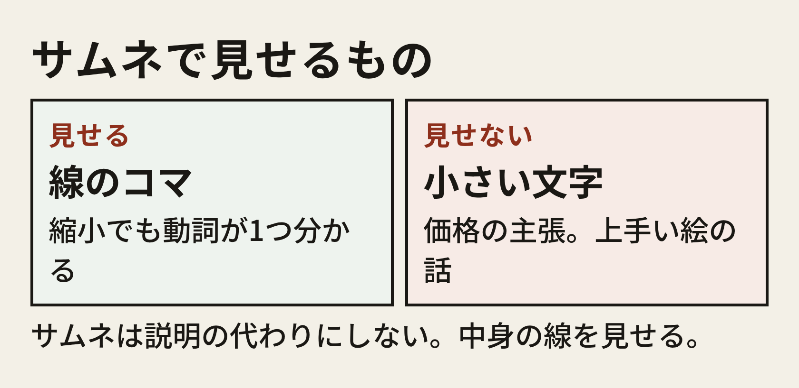

# 商品ページの構成

ファイルができた日に、出品画面を開く。画面の項目名はBOOTHのその日の表示に合わせて、この冊子が固定するのは埋める順だけ。

- 題名。動詞が、検索結果の1行で分かるようにする。例。床に座る線画素体・8ポーズ。例であり、僕の商品名ではない
- サムネ。中身の線が、縮小でも1コマは動詞として読める
- 説明。誰の止まり方に、何の線が置いてあるか。上手い絵の話は書かない
- ファイル。PNG1枚、またはPNGを入れたZIP。中身の枚数を、説明と一致させる
- タグ。棚で自分が検索した語を、そのまま戻す。新しい流行語を発明しない
- 年齢制限。線画でも、出品画面の選択肢を自分の目で選ぶ。冊子は区分の名前を決め打ちしない

題名の型は、動詞、中身、枚数の順。こんな感じ。

床に座る線画素体・8ポーズ。

立ちの体重・線画素体・8ポーズ。

振り返る肩・線画素体・6ポーズ。

3行とも例。枚数は、採用フォルダを数えた数と一致させて、数えてない枚数を題名に入れない。

説明を書く前に、ファイルを1回、自分のスマホに戻して開く。戻したファイルを拡大して、紙面の章で見た線が残ってるか確認する。出品画面のプレビューだけで公開しないでね。

# 説明文の記入例

型を先に置くね。括弧は、自分の動詞と、自分で数えた枚数に替える。価格の数字は型に入れない。

### 型

絵を描く人が、（動詞）の角度で線が止まるとき用です。

置いてあるのは、練習・資料用の線画素体です。白い背景と、黒い線だけです。衣装のデザイン、部屋、文字はありません。1コマを拡大して、体の角度の資料にしてください。

枚数は（採用フォルダを数えた数）です。形式はPNGです。複数ファイルのときはZIPで、中身はPNGです。

画像は、GrokのImagineで出した線を、スマホ上で選んで並べたものです。手描きのデッサンではありません。

価格は、棚で見たメモと、この枚数を見てから入れます。

個人が練習と資料に使う範囲を想定しています。再配布と、この線を主な中身にした商品化は、この例では断る文にしています。自分の配布条件に書き換えてください。

### 記入例。床に座る、8ポーズ

このブロック全体が例。僕の販売ページの文面じゃない。枚数の8は、前の章で言葉にした8ポーズと揃えるための例。

絵を描く人が、床に座る角度で線が止まるとき用です。

置いてあるのは、練習・資料用の線画素体です。白い背景と、黒い線だけです。衣装のデザイン、部屋、文字はありません。1コマを拡大して、体の角度の資料にしてください。

入っているポーズは次の8つです。両膝を曲げて片手を床につく。片足を前に出して両手を膝に置く。横座り。腕で膝を抱えない体育座りに近い形。片膝を立てる。斜め前から、片手を床につく。真横から、背中の線が読める。体重を後ろの手に預ける。

枚数は8です。形式はPNG、1枚の紙面です。

画像は、GrokのImagineで出した線を、スマホ上で選んで並べたものです。手描きのデッサンではありません。

個人が、絵の練習と資料に使うことを想定しています。ファイルの再配布、この紙面を主な中身にした商品の販売は断ります。

価格の文は、この例ではまだ書かない。棚で見た価格を自分のメモに残してから、次の章の手順で自分の数字を入れる。

説明文で足さない方がいいことも、短く置いておく。

- 上手い、美しい、プロ品質、という評価の語を足さない
- 売れた、人気、限定、を、事実が無い日に書かない
- 枚数を、採用より多く書かない
- 手描き、写真トレース、と読める語を書かない
- 特定の作家や作品の名前を、雰囲気の説明に使わない

# タグ、サムネ、価格

タグは、棚の手順で自分が検索窓に入れた語から選ぶ。新しく作った造語は、棚の人が検索しない。床に座る例なら、自分が実際に検索した語のうち、ポーズ、線画、資料、デッサン、クロッキー、から画面の枠に入る数だけ。枠の上限は出品画面に表示された数に合わせて、この冊子は上限の個数を断定しない。

タグに作家名や作品名を入れて検索を拾うと、ガイドラインの章にある依拠の話とぶつかる。

サムネは、説明の代わりのポスターにしない。中身の線を見せる。

- 紙面そのものを、正方形に収める。余白が片側だけ切れないようにする
- 縮小したとき、少なくとも1コマの動詞が分かる
- 価格、枚数、上手い、をサムネの中の文字にしない。文字は説明と題名に置く
- サムネ用に、別の完成イラストを生成しない。中身と違う顔の商品になる

価格の決め方は、考え方だけ書く。円の相場は断定しない。

- 先に、自分のファイルの事実を書く。枚数、PNGかZIPか、紙面が1枚か
- 次に、棚で開いた商品の価格を、見たものだけメモする。見ていない価格はメモしない
- 比べるのは、枚数と、線の資料かどうかだ。完成イラスト集と、線画素体を、同じ枚数で同じ価格帯だと決めない
- 自分の価格は、メモした範囲の中で、自分の枚数に近いものから起点を置く。メモが5件無ければ、その日は価格を決めない。棚に戻る
- BOOTHの手数料が別にあるかは、出品画面と公式ヘルプを、その日に読む。この冊子は料率を写さない。画面の数字が、冊子の記憶より優先だ

無料配布にする例もある。最初の1本を、反応を見るために0円にする、は考え方の一例で、0円が正解じゃない。0円でも、説明とガイドラインは省略しない。

年齢制限の区分は、線画であっても出品画面で選ぶ。練習と資料の線に留めていれば、刺激の強い区分は選ばない、が僕の置き方。画面の選択肢の文言は変わるので、選ぶ瞬間に表示を読んでね。

# ガイドライン上の注意

ここは、2026年11月14日に公式ページを開いて確認できた範囲だけ書く。改定されるから、出品の直前に同じURLを自分で開いてほしい。この冊子の記憶で、公開ボタンは押さない。

確認したページは、これ。

- 2023年5月16日のお知らせ「AI生成作品に対する、BOOTHにおける今後の対応とお願い」 https://booth.pm/announcements/646
- 2025年7月18日のお知らせ「BOOTHにおけるAI生成作品への対応強化について」 https://booth.pm/announcements/828
- サービス共通利用規約 https://policies.pixiv.net/
- ヘルプ「禁止商品とは何ですか？」 https://booth.pixiv.help/hc/ja/articles/13002467898905
- 2023年のお知らせが、あわせて読むように示している「要修正商品」 https://booth.pixiv.help/hc/ja/articles/13002520234521

2023年5月16日のお知らせで読めたのは、この範囲。同一の制作技術で他と差別化されていない作品を出すショップについて、全出品物を検索結果に載せない対応をすると書かれてる。検索に出るかどうかの基準は公開しない、とも書かれてる。対象は、制作過程がAIかどうかだけでは分けないと読める。写真と見紛うようなR-18画像をイラスト集やCG集として出品する例は、禁止商品だとこのお知らせが指してる。禁止商品と要修正商品のヘルプを読むようにも書かれてる。状況が改善しなければ、AI生成作品の多く、またはすべてを禁止せざるを得なくなる、とも書かれてる。禁止が実施された、とはこのお知らせには書かれてない。

2025年7月18日のお知らせで読めたのも、この範囲。監視を強める行為として、特定の作品・作家への依拠性が高い商品を出品することと、それに準ずる商品を大量・連続的に出品することが挙がってる。サービス共通利用規約の禁止行為に当たると確認された場合の対応として、商品の強制非公開、ショップの強制非公開、アカウント停止が、段階的または即時に行われると書かれてる。過去に対応された人が別名義で出してると判断した場合も同様、と書かれてる。共通規約の該当箇所として、情報解析の結果を用いて、反復継続して特定の第三者の作品、肖像または音声等に類似した投稿をすることなどが、お知らせの中で引用されてる。

この冊子の手順に引きつけると、出品前に自分で見るのはこのあたり。

- 作家名、作品名、実在の人物の名前を、プロンプトにも、題名にも、タグにも入れていない
- 同じ紙面の色を変えただけの商品を、連続して並べる計画になっていない。1本出して、記録を見てから次を考える
- 写真と見紛う年齢制限の画像を、資料集の顔で出していない。この冊子の中身は線画素体に限る
- 説明文に、Imagineで出した線だと書いてある。手描きだと読める語が残っていない
- 禁止商品と要修正商品のヘルプを、その日の文言で開いた

表記が義務かどうかは、上のページを読んだ範囲では、義務だと断定できる文を見つけてない。それでもこの冊子の記入例では、Imagineで出した線だと説明に書く。買う人が、手描きのデッサンだと誤解しないように。義務の有無は、出品の日に公式ページで更新を見てね。

共通規約のURLは、お知らせが指してるページ。条文番号の細目は、開いたページのその日の版を読む。冊子に写した要約で、条文の代わりにしないで。
