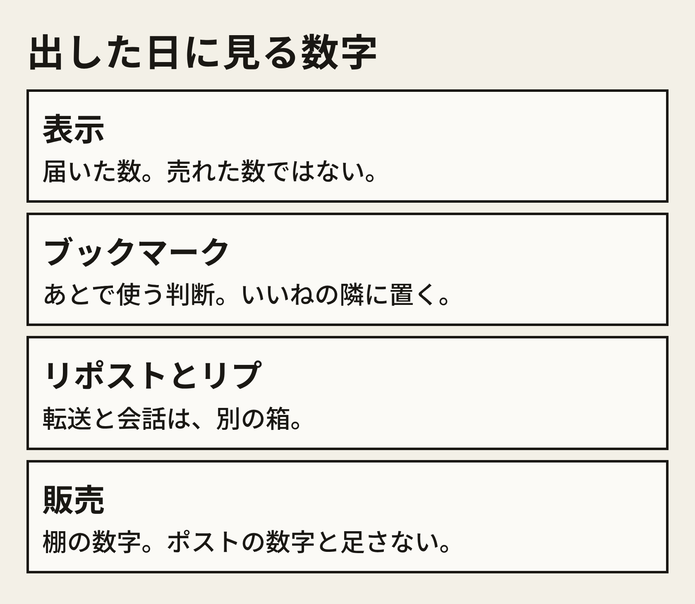
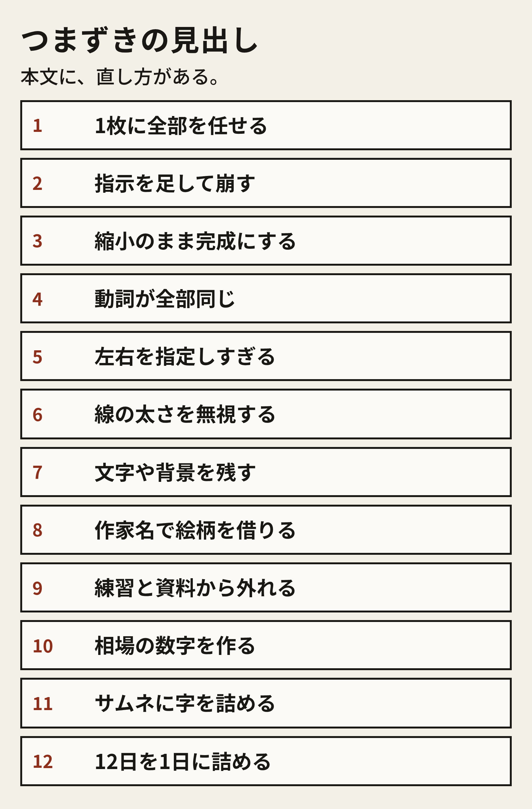
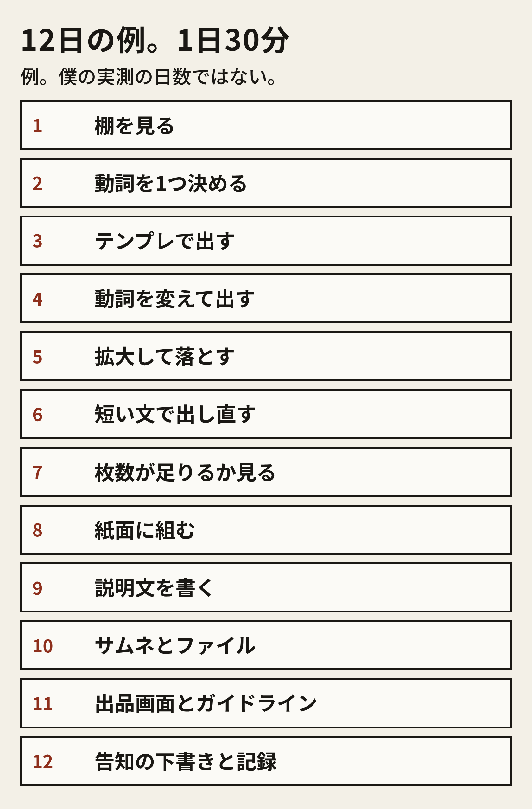

# 出したあと

公開ボタンを押した日と、Xに下書きを置いた日は、分けてよい。同じ30分に両方を終える必要は無い。

見る数字は、箱を混ぜない。

- 表示。ポストが届いた数。売れた数ではない
- いいね。その場の反応
- ブックマーク。あとで使う判断。僕はここを、いいねの隣に置く
- リポスト。転送
- リプと引用。会話
- 販売数と売上。BOOTHの画面の数字。ポストの数字と足さない

元ポストの公開値は、箱の見本として1回だけ置く。2026年11月14日時点で、表示191,013、いいね1,823、ブックマーク1,843、リポスト166、リプ21、引用1。ブックマークがいいねを上回っている。会話は少ない。この並びを、自分のポストの目標値にはしない。自分の画面に出た数だけを、記録シートに写す。

次の一手は、数字の種類で変える。

- ブックマークが、いいねと同じか上回る。資料として保存されている可能性が高い。次の30分は、同じ動詞の隣の手の位置を8枚足すか、説明の1行を具体にする
- 表示はあるのに、ブックマークがほとんど無い。題名の動詞が、棚の言葉とずれている可能性がある。次の30分は、棚のメモと題名を並べる。生成は開かない
- リプで、線が読めないと言われた。次の30分は、該当コマを拡大して、採用の4点に戻す。弁解の文を先に書かない
- 販売の画面を、まだ開いていない。販売数は空欄のままにする。ポストの表示を、売上の代わりに書かない

Xの告知は、下書きを先にメモへ置く。投稿ボタンは、自分で押す。この冊子は投稿しない。

### 告知の型。例

床に座る角度で、線が止まっていないか。

僕はスマホのImagineで、線画素体を8ポーズにして1枚にまとめた。練習と資料用だ。背景も、衣装のデザインも入れていない。

選んだ理由は3つだ。描く人がそこで止まりそうか。30分で1工程進むか。スマホの中で閉じるか。

これは型の例だ。8ポーズは、通し例の枚数だ。自分の投稿では、採用フォルダを数えた数に替える。表示や販売の数字は、画面に出た日だけ、別の行に足す。

告知に入れないものも固定する。

- 収入の話、仕事を辞める話、結果を保証する語
- 見ていない相場
- 僕が打った実物だと読めるプロンプトの全文。汎用テンプレをそのまま貼るなら、「型の例」と書く
- ガイドラインのURLを、自分で開いていない日に「問題ない」と書くこと

# つまずき集

12個ある。それぞれの直しは、才能の話にしない。次の30分で、手をどこに置くかだけ書く。

1枚に全部を任せる。ポーズと、紙面と、線の統一を、1回の生成に入れる。直しは、1ポーズに戻す。4×4は、選んだあとに組む。

指示を足して崩す。指の本数や角度を足すほど、別の場所が壊れる。直しは、テンプレEの短い文に戻し、壊れたコマは捨てる。

縮小のまま完成にする。一覧で埋まって見える。直しは、採用の日を別にし、手、足、接地、重心の順で拡大する。

動詞が全部同じ。8枚が、片手を床につくだけになる。直しは、テンプレDで手の位置を変えた枚と入れ替える。水増しの枚は不採用フォルダへ移す。

左右を指定しすぎる。右手と左手を同時に書く。直しは、どちらか1つだけ残し、保存後に向きを見る。

線の太さを無視する。細いコマと太いコマを1枚に載せる。直しは、近い太さだけを採用する。アプリで太さを揃えられない日は、混在のまま出さない。

文字や背景を残す。隅の文字、窓、家具。直しは、そのコマを落とす。「文字は入れない」「部屋は描かない」はテンプレに残っているかを見る。文を3行足さない。

作家名で絵柄を借りる。上手く見えたコマほど、ここで止まる。直しは、その語を消してテンプレAから出し直す。題名とタグからも、固有名を消す。

練習と資料から外れる。肌の描写や、衣装のデザインや、姿勢の意味が資料ではなくなる。直しは、問答しないで落とす。この冊子の商品は、線画素体に限る。

相場の数字を作る。見ていない価格や、販売数を説明に書く。直しは、棚のメモか、BOOTHの画面に出た数だけを残す。無い欄は空欄にする。

サムネに字を詰める。価格や「高品質」を画像の中に入れる。直しは、紙面の線だけを正方形に収める。主張は題名と説明に移す。

12日を1日に詰める。出す、選ぶ、組む、出品を、通勤の1回で終える。直しは、日程の例の1行だけを、その日の30分にする。終わらなかった行は、翌日の先頭に残す。

12個のどれにも当たらない日は、記録シートの「失敗」に、自分の言葉で1行書く。原因、気づき、次に変えること、まで書いてから画面を閉じる。1行で止めると、次の30分に同じ場所で止まる。

# 30分×12日の例

この日程は例だ。僕がこの本数を、この日数で出した記録ではない。1日30分を、12回に分けている。途中で枚数が足りなければ、3日目か4日目に戻る。12日で公開が義務ではない。

- 1日目。棚を見る。検索語を1つずつ。メモは3行
- 2日目。動詞を1つ決める。描かせない3語を書く。床に座る例なら、文字、衣装のデザイン、部屋
- 3日目。テンプレAとBで出す。保存して、ファイル名を付ける。拡大しない
- 4日目。テンプレCとDで、向きと手の位置を変えて出す
- 5日目。拡大する。手、足、接地、重心。不採用を別アルバムへ移す
- 6日目。足りない動詞だけ、テンプレEで出し直す。1動詞につき、足す語は1つまで
- 7日目。採用の枚数を数える。8枚以上なら次へ。6枚なら6枚の割り方にする。それ未満なら3日目に戻る
- 8日目。Canva、ibisPaint、Adobe Express、Photopeaのどれかで紙面にする。PNGで書き出し、もう一度拡大する
- 9日目。説明文の型を、自分の動詞と、数えた枚数で埋める。価格の文は、まだ書かなくてよい
- 10日目。サムネを紙面から作る。ファイルを自分のスマホに戻して開く
- 11日目。出品画面を埋める。ガイドラインの5つのURLを開く。公開は、開いたあとに自分で判断する
- 12日目。告知の下書きをメモに置く。記録シートを、その日の事実で埋める

各日の終わりに、1行だけ残す。今日終わった工程、明日の工程。この2つが書いてあれば、通勤の途中でやめてよい。

# 記録シートの記入例

シートの欄は、毎日同じでよい。下の「空の欄」を、メモアプリにコピーする。その下の「記入例」は、床に座る例の5日目として書いてある。例なので、枚数以外の実績は入れていない。数えていない欄は、例でも空欄のままにしてある。

### 空の欄

- 日付
- 工程。出す、選ぶ、まとめる、置く、のどれか1つ
- 今日の動詞
- 棚で見た事実。見た語と、見た価格があればそれだけ
- 描かせないもの3つ
- 使ったテンプレ。AからFのどれか。自分で動詞を替えた行
- 生成して保存した枚数。数えたら書く
- 採用にした枚数。数えたら書く
- 落とした理由。手、足、接地、重心のどれか
- 失敗
- 原因
- 気づき
- 次に変えること
- ポストを出したら、表示、いいね、ブックマーク、リポスト、リプ、引用
- 販売数と売上。画面を見たら書く
- 商品URL。公開したら貼る
- 明日の1工程

### 記入例。5日目、選ぶ

このブロックは例だ。

- 日付。例なので、特定の暦日は置かない
- 工程。選ぶ
- 今日の動詞。床に座る
- 棚で見た事実。この例では、2日目に見たと仮定して「ポーズ集を検索し、題名に全身が多かった」とだけ書く。価格は見ていないので書かない
- 描かせないもの。文字、衣装のデザイン、部屋
- 使ったテンプレ。この日は生成していない。3日目と4日目にA、B、C、Dを使った、と例では書いておく
- 生成して保存した枚数。この日は数えていないので空欄
- 採用にした枚数。例では、指で数えて8枚だった、と書くための欄だ。実際に数えるまでは8と書かない。ここは書き方を示す例なので、8は通し例の枚数だと分かるように残す
- 落とした理由。例。手の形が読めないコマと、足が浮いたコマを、不採用アルバムへ移した
- 失敗。縮小の一覧で、いったん全部採用にしそうになった
- 原因。完成の定義を、コマが埋まっていることに置いていた
- 気づき。拡大の順を、手からに固定すると、落とし忘れが減る
- 次に変えること。明日はテンプレEで、浮いた足の動詞だけ出し直す。語は「足が床に着いている」の1つだけ足す候補にする
- ポストの数字。この日はポストしていないので空欄
- 販売数と売上。空欄
- 商品URL。空欄
- 明日の1工程。短い文で出し直す

空欄を恥ずかしがらない。空欄は、見ていない、という記録だ。見た顔で埋めた数字の方が、次の30分を壊す。

僕の販売数、僕が払った手数料、僕がImagineに打った実物の全文は、この冊子に無い。公開値は、先の章に書いた元ポストの6つだけだ。テンプレは、今日からコピーして動詞を替えるための例だ。
